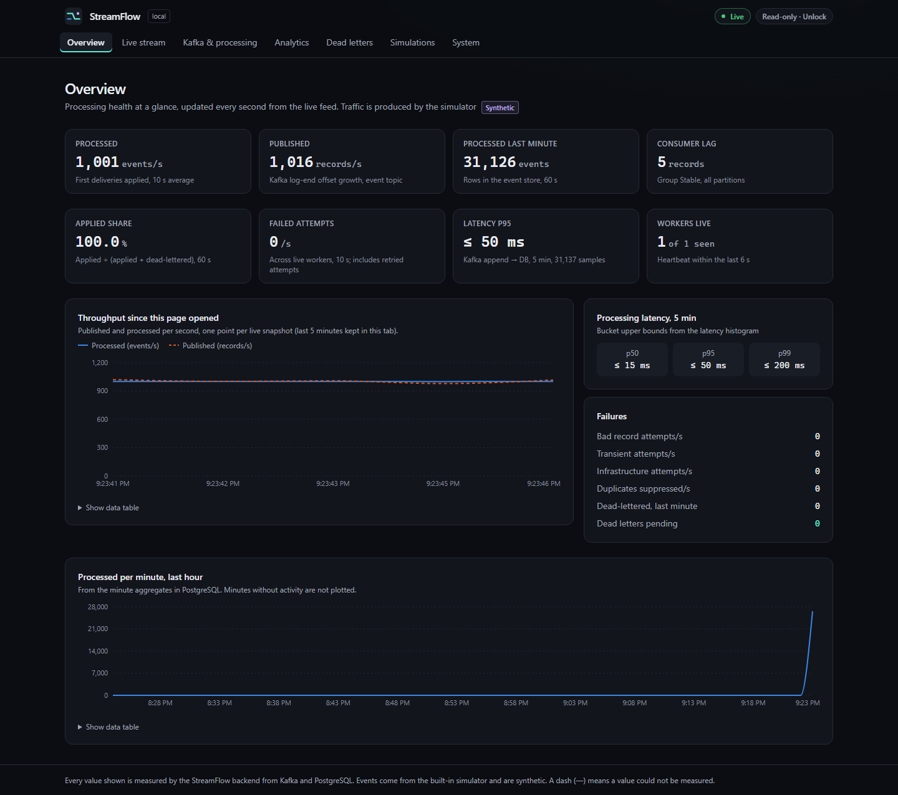
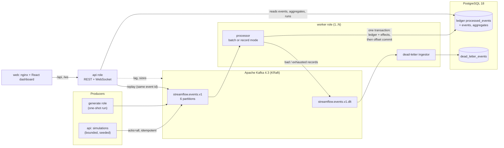
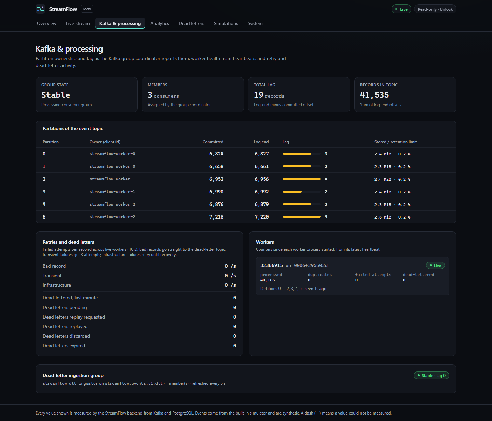
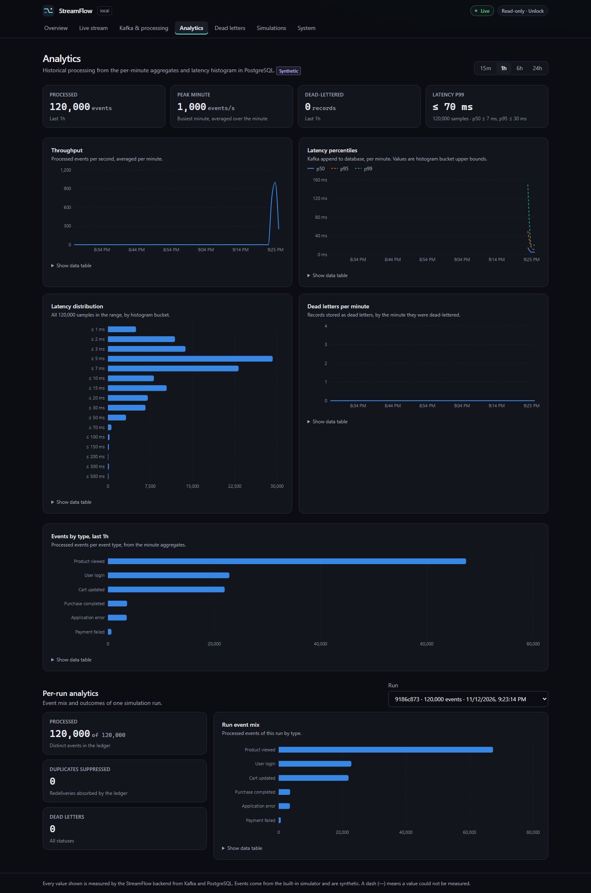
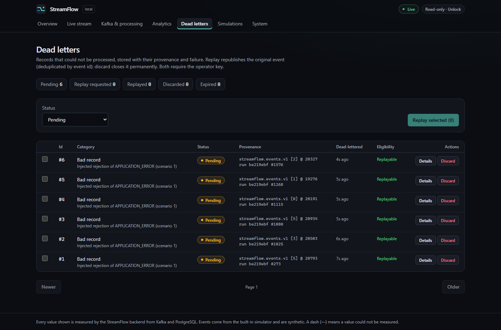
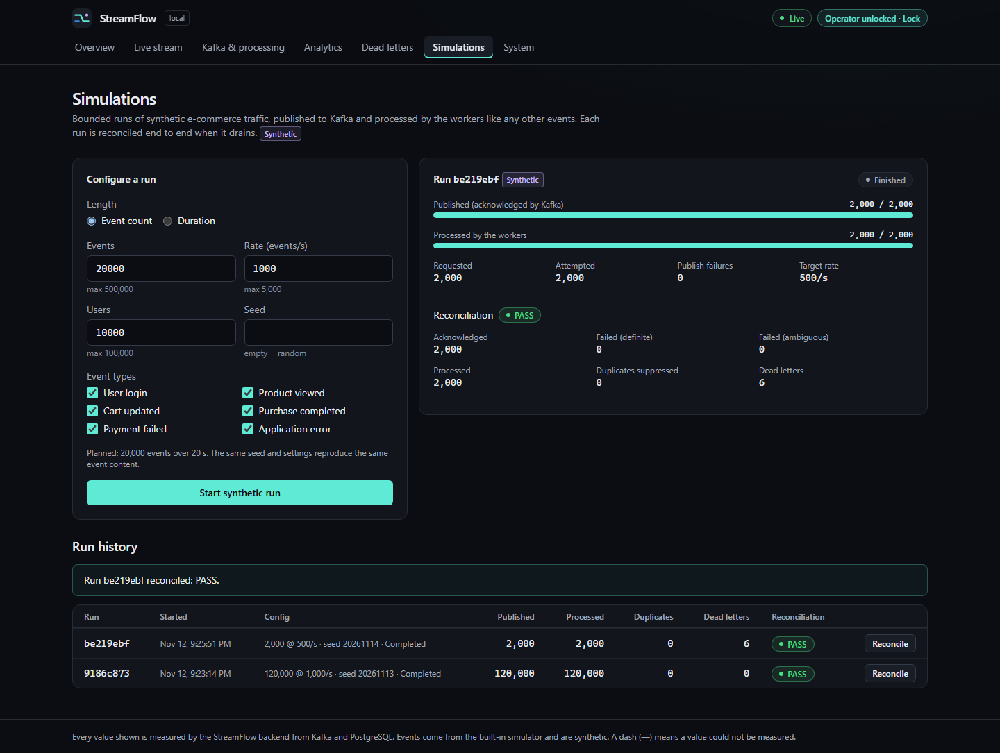

# StreamFlow

[](https://github.com/gladwynL/StreamFlow/actions/workflows/ci.yml)

**A real-time event streaming and analytics platform built with Java 21, Spring Boot 4, Apache Kafka,
PostgreSQL and React.** Synthetic e-commerce events are published to Kafka, processed by independent
workers into PostgreSQL with explicit, tested delivery guarantees, and shown on a live dashboard.

The interesting part is not moving events into a table. It is what happens when things fail. Workers
are killed mid-transaction, the database or broker disappears, records are malformed, or Kafka deletes
data nobody has read. Each of these is reproduced by an automated test against real Kafka and PostgreSQL.



<sub>Real screenshot from the [local walkthrough](docs/walkthrough.md): a seeded synthetic run at 1,000 events/s,
one worker. All values come from the backend.</sub>

## Highlights

- **At-least-once delivery, duplicate-free effects.** Every event is applied in one PostgreSQL transaction together
  with its row in a deduplication ledger. Kafka offsets are committed only after that transaction commits, so
  redeliveries are absorbed rather than double-counted.
- **Crash recovery proven with real crashes.** Test JVMs are halted before and after the database commit, after a
  dead-letter publication, and in the middle of a replay. Nothing is lost and nothing is applied twice.
- **Classified failure handling.** Bad records are dead-lettered at once. Transient failures are retried three
  times. Infrastructure outages pause processing instead of flooding the dead-letter topic.
- **Dead letters, replay and reconciliation.** Operators can inspect, replay or discard dead letters. Replay keeps
  the event's identity, so it is idempotent. Every run is reconciled against the producer's acknowledgements as
  PASS, FAIL or INCOMPLETE.
- **Measured performance, with a profiled fix.** Profiling found per-record commit latency was the bottleneck. A
  batch processing mode with the same guarantees raised one worker's drain from 941 to 15,548 events/s on a laptop.
- **A dashboard about streaming, not uptime.** It shows partitions, lag, retention headroom, workers, retries, dead
  letters, simulations and reconciliation. It is accessible (axe-checked) and responsive.

## Architecture



One Spring Boot application, one image, separate **runtime roles** (`migrate`, `api`, `worker`, `generate`,
`loadgen`) selected by profile, so workers can be killed and scaled on their own
([ADR-0001](docs/adr/0001-single-codebase-runtime-roles.md)). Design: [Phase 0 architecture](docs/planning/phase-0-architecture.md)
and [13 decision records](docs/adr/).

## Tech stack

| Area | Technology |
|---|---|
| Backend | Java 21, Spring Boot 4.1, Spring for Apache Kafka, Spring JDBC (`JdbcClient`), Flyway |
| Messaging and storage | Apache Kafka 4.3 (KRaft), PostgreSQL 18 |
| Frontend | React 19, TypeScript, Vite, Tailwind CSS, TanStack Query, Recharts |
| Testing | JUnit 5, Testcontainers (real Kafka and PostgreSQL), Awaitility, ArchUnit, Vitest, Testing Library, Playwright, axe-core |
| Delivery | Docker Compose, GitHub Actions, Dependabot |

Exact versions: [`docs/versions.md`](docs/versions.md).

## Engineering challenges and how they were solved

| Challenge | Solution | Evidence |
|---|---|---|
| Kafka redelivers after crashes and rebalances | Ledger primary key on the event id, written in the same transaction as the effects; offsets committed after the database commit | `CrashRecoveryIT`, `DuplicateDeliveryIT`, `ConcurrentProcessingIT` |
| A database outage would dead-letter every record | Failures classified as bad record, transient or infrastructure; infrastructure failures retried with capped back-off, never dead-lettered | `DatabaseOutageIT`, `KafkaOutageIT` |
| Dead-letter publication can fail too | The source offset is committed only after the dead-letter record is acknowledged | `DeadLetterPublishFailureIT` |
| Replaying could apply an event twice | Replay republishes the original event id; concurrent replays are claimed row by row | `ReplayIT`, `ReplayCrashIT` |
| "Did every event arrive?" | Per-run reconciliation of producer outcomes against the ledger | `ReconciliationIT` |
| One commit per record capped throughput near 1,000/s | Batch mode: one transaction per poll batch with set-based SQL, falling back record by record so offsets still follow durable effects | `BatchProcessingIT`, [benchmarks](docs/benchmarks/README.md) |
| Spring Kafka's batch retry stalled the consumer after a broker outage | Found by a new outage test; failed commits now redeliver the batch instead | `KafkaOutageIT`, [findings](docs/verification/spring-kafka-behavior.md) |
| Kafka retention can delete unread events | The partition is paused, the gap is recorded with the number of events lost, and recovery is a deliberate operator step; nothing is skipped silently | `OffsetOutOfRangeIT` |

The full write-up is in the [case study](docs/case-study.md).

## Reliability evidence

[`docs/reliability.md`](docs/reliability.md) lists **41 claims, each mapped to the automated test that proves it**.
The integration suite runs twice in CI, once per processing mode. The claims cover:
- crashes before and after commit;
- duplicate and concurrent delivery;
- database and broker outages;
- retries, dead letters and replay (once, twice, concurrently, with a crash);
- reconciliation, retention and offset gaps;
- operator protection.

StreamFlow does **not** claim exactly-once delivery. It claims at-least-once delivery with effects applied once,
and the documentation states where that claim ends.

## Performance (local measurements)

Measured with the benchmark harness on one laptop: a 6-core Ryzen 5 PRO 7540U running Docker Desktop, with every
component sharing one machine. Figures are medians of repeated runs with their ranges, and every one of the 97
matrix runs reconciled exactly. They describe this machine, not production capacity.
[Method](docs/benchmarks/methodology.md) · [results](docs/benchmarks/README.md) · [raw data](benchmarks/results/)

| Measurement (1 worker × 3 consumer threads) | Record mode | Batch mode (default) |
|---|---|---|
| Backlog drain throughput | 941 events/s (783–983) | **15,548 events/s** (14,276–16,598) |
| Latency p50 / p95 / p99 at 500 events/s offered | 7.1 / 548 / 1,463 ms | **5.8 / 27.7 / 361 ms** |
| WAL fsyncs per 1,000 events | 817 | 1.8 |

- **Producer:** 63,247 events/s (61,679–69,683), acknowledged with `acks=all`.
- **Worker killed mid-drain:** partitions stalled for 18.5 s, and every run still reconciled PASS.
- **Unexplained:** one of three batch runs at 750 events/s had a 7.7 s p95; its cause is a documented uncertainty.

## Screenshots

| | |
|---|---|
|  Partitions, owners, lag and retention headroom |  Analytics from per-minute aggregates |
|  Dead letters from a controlled fault, with provenance |  Replayed, then reconciled: PASS |

Every screenshot comes from the [walkthrough](docs/walkthrough.md) of a fresh clone. Events are synthetic and
labelled as such in the UI.

## Run it locally

Requires Docker Desktop (about 4 GB of free memory) and Git.

```bash
git clone https://github.com/gladwynL/StreamFlow.git && cd StreamFlow
cp .env.example .env     # set POSTGRES_PASSWORD (and STREAMFLOW_OPERATOR_KEY for operator actions)
docker compose --profile app up -d --build --wait
```

Open http://localhost:8080. Start a bounded synthetic run from **Simulations** (it needs the operator key), or
publish a seeded run from the command line:

```bash
docker compose run --rm --no-deps generate
```

On the walkthrough laptop a cold build took 4 minutes and startup took 35 seconds. Stop the stack with
`docker compose --profile app stop`; data stays in named volumes. More details are in the
[runbook](docs/runbook.md), which covers operations, troubleshooting and local development without Docker.

## Testing and CI

| Suite | What it covers |
|---|---|
| Backend unit tests | Classification, retry policy, reconciliation, latency buckets, status, operator guard, OpenAPI coverage, ArchUnit role boundaries |
| Backend integration tests (Testcontainers) | The reliability suite against real Kafka and PostgreSQL, in **both** processing modes |
| Frontend | Vitest and Testing Library for every section; ESLint with zero warnings; production build |
| End to end | Playwright against the real Compose stack: every section, axe accessibility scan, three viewport sizes, keyboard navigation, a seeded run that must reconcile, and dead-letter replay and discard |
| Compose smoke test | A clean stack, a published run that must reconcile PASS, and security-header assertions |

[GitHub Actions](.github/workflows/ci.yml) runs all of them on every push. The benchmark harness has its own
smoke scenario.

## Limitations

StreamFlow is built and verified as a **local, single-user system**:
- one Kafka broker with replication factor 1;
- one PostgreSQL instance;
- no TLS and no user accounts;
- operator actions protected by a shared key with a rate limit;
- every port bound to 127.0.0.1.

Other limitations:
- Per-key order is not kept for events that are dead-lettered and replayed.
- Events deleted by retention before they were read are lost. They are recorded and reported, never skipped
  silently.
- Performance figures come from one laptop and are not production capacity.

Partition counts other than 6, the KIP-848 consumer protocol and multi-machine scaling were not measured. Details
are in the [security notes](docs/security.md) and in the limitations sections of
[`docs/reliability.md`](docs/reliability.md) and [`docs/benchmarks/README.md`](docs/benchmarks/README.md).

## Documentation

| Document | Contents |
|---|---|
| [Case study](docs/case-study.md) | Problem, design, failure handling, the batch optimisation, lessons learned |
| [Walkthrough](docs/walkthrough.md) | Timed fresh-clone walkthrough with screenshots |
| [Architecture](docs/planning/phase-0-architecture.md) · [ADRs](docs/adr/) | Design and decisions |
| [Reliability](docs/reliability.md) | Every claim and its test |
| [Benchmarks](docs/benchmarks/README.md) | Performance results, method and limitations |
| [API](docs/api.md) · [OpenAPI](docs/openapi.yaml) | REST and WebSocket API |
| [Runbook](docs/runbook.md) | Setup, operations, troubleshooting |
| [Security](docs/security.md) | Threat model and controls |
| [Spring Kafka findings](docs/verification/spring-kafka-behavior.md) | Framework behaviour verified, not assumed |

## Repository layout

```
backend/     Maven build: streamflow-events (event contract), streamflow-app (Spring Boot roles)
frontend/    React dashboard (Vite) with unit and Playwright tests
benchmarks/  benchmark harness (run.sh, scenarios, analyze.py) and committed raw results
docs/        architecture, ADRs, reliability claims, benchmarks, runbook, case study
compose.yaml Docker Compose stack (plus overlays for end-to-end tests and benchmarks)
```

## License

[MIT](LICENSE)
