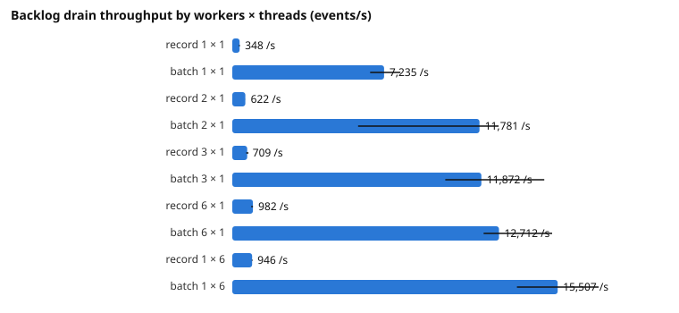

# StreamFlow performance (Phase 5)

Measured 2026-11-12 on one laptop, with the harness and method in [methodology.md](methodology.md). Every figure
below is the **median of three or more repetitions with the range (min–max)**, and every run included in it
reconciled as PASS (all acknowledged events applied exactly once, nothing missing, nothing unexpected). Generated
tables for all 97 runs: [results.md](results.md); raw measurements: [`benchmarks/results/`](../../benchmarks/results/).

These are single-host results: producer, broker, database and workers share one 6-core laptop CPU and one Docker VM.
They describe this system on this machine; ratios between configurations are more meaningful than absolute values.
Earlier "preliminary observations" (Phase 4, runbook) are not benchmark results and are not mixed in here.

## Environment

| Item | Value |
|---|---|
| Host | Lenovo ThinkPad P16s, AMD Ryzen 5 PRO 7540U (6 cores / 12 threads), 16 GB (11.7 GB usable), Windows 11 Pro |
| Docker | Docker Desktop, engine 29.8.0, WSL 2 VM with 12 CPUs and 5.6 GiB memory (default cap) |
| Containers | Kafka 4.3.2 (1 GiB limit, 512 MiB heap), PostgreSQL 18.6 (768 MiB, `shared_buffers` 256 MB, `synchronous_commit=on`, `fsync=on`), workers 512 MiB each (384 MiB with six), loadgen 768 MiB |
| JVM | Temurin 21.0.13, `-XX:MaxRAMPercentage=70`; the JVM selected the Serial collector for these container sizes |
| Data | Seeded synthetic events (10,000 users), about 580 bytes per record uncompressed, **110 bytes per event on Kafka's disk** (lz4); 6 partitions |
| Code | Application commits `76d5330` (before) and `641bcaa` and later (after the optimisation); every run's commit and environment are in its `manifest.json` |

## Headline results

| Measurement | Result |
|---|---|
| Producer, acknowledged (acks=all, idempotent, lz4), 480,000-event runs | **63,247 events/s** (61,679–69,683) |
| Consumer, record mode, 1 worker × 3 threads, before → after optimisation (n = 5 each) | **725 → 941 events/s** (654–869 → 783–983) |
| Consumer, batch mode, 1 worker × 3 threads | **15,548 events/s** (14,276–16,598) |
| Latency p50 / p95 / p99 at 500 events/s, batch mode | **5.8 / 27.7 / 361 ms** |
| Latency p50 / p95 / p99 at 500 events/s, record mode | 7.1 / 548 / 1,463 ms |
| Worker killed during a drain (record mode, 2 workers × 3) | partitions stalled **18.5 s** (15.9–19.9); 573–1,359 redeliveries suppressed; 3/3 reconciled PASS |

## 1. The Phase 4 throughput ceiling, investigated

**Hypothesis (Phase 4):** one worker processes about 700–800 events/s and PostgreSQL is busy.

**Measured baseline** (record mode, one worker × 3 consumer threads, 60,000-event backlog, n = 5): **725 events/s
(654–869)**, so the observation was reproduced. But neither PostgreSQL (mean 1.1 of 12 CPUs) nor the worker (0.8)
was CPU-bound, so "PostgreSQL is busy" was not the cause.

**Profiling** (Java Flight Recorder, `settings=profile`, on the worker): the consumer threads were rarely running
Java code (581 execution samples against 3,963 native-method samples in an 85 s recording) and almost always
blocked in native socket reads. Attributing every
native-method sample of the consumer threads to its call site:

| Where record-mode consumer threads waited (baseline) | Share of samples |
|---|---|
| `COMMIT` (WAL flush + round trip) | 49.8 % |
| Ledger insert | 11.8 % |
| Latency-histogram upsert (added in Phase 4) | 10.5 % |
| Event row insert | 7.8 % |
| Minute-aggregate upsert | 7.4 % |
| Run-statistics upsert | 6.7 % |
| Kafka poll and other | 6.0 % |

`pg_stat_statements` agrees: each statement executed in 0.13–0.26 ms on the server, while `pg_stat_io` showed one
WAL flush per transaction at about **1 ms per fsync** (Docker VM virtual disk). GC was negligible (1.08 s of pauses in
85 s). **The dominant bottleneck is per-record synchronous latency: one durable commit plus five sequential round
trips per record, per consumer thread** — not CPU and not a missing index. The Phase 4 latency histogram costs about
10 % of the waiting time: measurable, not dominant.

## 2. Optimisation 1 — fewer round trips per record (record mode)

The four effect writes of a first delivery (event row, minute aggregate, latency histogram, run statistics) became one
statement with data-modifying CTEs, after the ledger insert: the same tables, keys, conflict handling and
transaction; two round trips per record plus the commit instead of five plus the commit. Reliability tests
unchanged and passing.

| Record mode, 1 worker × 3 (n = 5 each, back to back) | Before (`76d5330`) | After (`641bcaa`) |
|---|---|---|
| Consumer throughput | 725 /s (654–869) | **941 /s (783–983)** |
| Drain of 60,000 events | 82.8 s (69.1–91.7) | 63.7 s (61.0–76.6) |
| Total statement time | 32.3 s | 25.1 s |
| Share of waiting in statements / in `COMMIT` | 44 % / 50 % | 38 % / 56 % |

About **+30 % at the median**; the ranges touch at the edges (869 vs 783), so the gain is real but the exact size is
uncertain with five repetitions on a noisy host. After it, the commit is clearly the dominant cost — which only
amortising commits can address.

## 3. Optimisation 2 — batch processing mode (ADR-0013)

One database transaction per poll batch with set-based statements (`unnest` arrays, rows sorted by event id), and a
record-by-record fallback that reports the first failing record to Spring Kafka (`BatchListenerFailedException`), so
offsets are committed only for records whose effects have committed. Guarantees and their tests: ADR-0013.

| 1 worker × 3 threads | Record (after opt. 1) | Batch | Ratio |
|---|---|---|---|
| Consumer throughput | 941 /s (783–983) | **15,548 /s (14,276–16,598)** | 16.5× |
| Events per database transaction | 1.0 | 410 (405–419) | |
| WAL fsyncs per 1,000 events | 817 | 1.8 | |
| Worker CPU, mean (% of one core) | 63 | 97 | |
| PostgreSQL CPU, mean | 109 | 177 | |

In batch mode the consumer threads wait on PostgreSQL executing the set-based inserts (ledger 30 %, event rows 25 %,
commit 12 % of samples; about 27 ms and 16 ms per batch of ~490 rows) and on Kafka polls (25 %). GC pauses rise to
about 8 % of the time.

**Latency is not worse at low load** — batches simply become smaller (1 worker × 3, 60 s per rate, n = 3):

| Offered | Record p50 / p95 / p99 ms | Batch p50 / p95 / p99 ms |
|---|---|---|
| 250 /s | 6.8 / 33.0 / 456 | 6.9 / 22.9 / 395 |
| 500 /s | 7.1 / 548 / 1,463 | 5.8 / 27.7 / 361 |
| 750 /s | 9.9 / 1,103 / 1,555 | 6.7 / 53.7 / 558 |

At 750 /s record mode runs at about 80 % of its capacity and its tail latency grows. One of the three batch runs at
750 /s had an outlier (p95 7.7 s, p99 9.8 s; included in the ranges in results.md) that the other two did not show;
its cause was not isolated.

**Decision:** batch mode is the **default** (`streamflow.worker.processing-mode=BATCH`). It is 16× faster at the
default worker shape, its latency is equal or better at every tested load, and the full reliability suite passes in
both modes (CI runs it twice). Record mode remains available and tested as the reference
(`STREAMFLOW_WORKER_PROCESSING_MODE=RECORD`).

## 4. Scaling (6 partitions, backlog drain)

Workers × consumer threads per worker; each consumer thread owns 6 ÷ consumers partitions. Speed-up is relative to
1 × 1 of the same mode.

| Workers × threads | Record /s | Speed-up | Batch /s | Speed-up |
|---|---|---|---|---|
| 1 × 1 | 348 (314–361) | 1.00× | 7,235 (6,569–8,013) | 1.00× |
| 2 × 1 | 622 (620–624) | 1.79× | 11,781 (5,995–12,692) | 1.63× |
| 3 × 1 | 709 (665–773) | 2.04× | 11,872 (10,153–14,869) | 1.64× |
| 6 × 1 | 982 (902–983) | 2.82× | 12,712 (11,979–15,246) | 1.76× |
| 1 × 6 | 946 (932–964) | 2.72× | 15,507 (13,567–17,459) | 2.14× |

- **Record mode scales sub-linearly**, limited by durable commits. Commits per second grow from 351 (1 consumer) to
  988 (6 consumers) while WAL fsyncs flatten at 500–760 per second: PostgreSQL starts grouping commits into one flush
  (about two commits per fsync with six workers), but every flush still costs about 1–1.3 ms on this disk and
  per-statement time rises with concurrency. More consumers help, with diminishing returns near 1,000 commits/s.
- **Batch mode is CPU-bound on this host**: at six workers the containers use about 6.5 cores (workers 3.6,
  PostgreSQL 2.7 on average), most of this 6-core CPU; throughput levels off at 12–15k events/s.
- **Threads beat processes here**: one worker with six threads matches or beats six one-thread workers in both modes
  while using far less CPU (each extra JVM adds polling, heartbeats, JIT and GC on the same CPU). Separate processes
  remain the way to scale across machines, which this single-host benchmark cannot show.
- Multi-worker batch runs vary more (for example 5,995–12,692 /s at 2 × 1): workers join the group one after another,
  and the resulting rebalances pause consumption for seconds of a ~40 s drain.
- With 60,000-event backlogs the batch runs drained in 4–10 s and mostly measured worker start-up; those results are
  kept (commit `d5287d5` in results.md) but the batch figures above use 480,000-event backlogs.

Horizontal scaling is therefore demonstrated only within this host's limits: more consumers increase throughput in
both modes, until commit latency (record) or the host CPU (batch) dominates.

## 5. Partition skew

With 50 % of events belonging to one user (`HOT_USER_PERCENT=50`), one partition receives 57 % of the traffic
(34,478 of 60,000 events; skew 3.45 = busiest partition ÷ mean). Record mode, 1 worker × 6 threads: **594 /s
(585–619)** instead of 946 /s with uniform keys — the drain lasts as long as the single consumer of the hot partition
needs. Per-key ordering (one partition per key) is what caps a hot key; it also shrinks the Kafka backlog window for
that partition (below). Uniform runs are even: skew 1.05–1.06.

## 6. Worker failure and recovery

One of two workers (× 3 threads) is killed with SIGKILL and restarted 15 s later; 3 repetitions per mode, all
reconciled PASS.

| Mode, workload | Longest partition stall | Max event latency | Duplicates suppressed |
|---|---|---|---|
| Record, 60,000-event backlog | 18.5 s (15.9–19.9) | 68.3 s (backlog wait included) | 837 (573–1,359) |
| Batch, 3,000 events/s live | not measured (see note) | 12.6 s (12.3–13.1) | 15 (1–144) |

The stall matches the consumer session timeout (10 s) plus the rebalance and restart. Redelivered records whose
effects had committed before the kill were suppressed by the ledger, so the reconciliation stayed exact. In live runs
the lag timeline starts after publication and does not cover the kill; the maximum event latency (12.6 s, against a
p50 of a few milliseconds in steady state) bounds the disruption instead.

## 7. Dashboard open versus closed

The baseline drains with the api running and three live-feed WebSocket clients connected:

| | Without dashboard | With 3 dashboard clients |
|---|---|---|
| Record, 1 × 3 | 941 /s (783–983) | 948 /s (941–1,068) |
| Batch, 1 × 3 | 15,548 /s (14,276–16,598) | 18,861 /s (16,554–19,990) |

No measurable overhead in record mode. The batch runs with the dashboard were faster, which the dashboard cannot
cause; they ran later in the session, and the difference shows the size of between-session noise on this host rather
than a dashboard effect.

## 8. Kafka backlog window (Phase 0 §6.2)

On-disk size per event: **110.3 bytes** (52,943,091 bytes for 480,000 events, lz4 batches; one measurement). The
supported backlog window W = min(24 h, (1 GiB − 128 MiB) ÷ per-partition ingress):

| Sustained ingress (uniform over 6 partitions) | W |
|---|---|
| ≤ 590 events/s | 24 h (time retention) |
| 1,000 events/s | 14.2 h |
| 5,000 events/s | 2.8 h |
| 20,000 events/s | 43 min |
| 63,000 events/s (measured producer maximum) | 13.5 min |

With a hot key the hot partition fills proportionally faster (57 % of traffic on one partition shortens W 3.4-fold).

## 9. Reliability validation

- Every benchmark run reconciled as PASS: 97 runs, 0 excluded.
- The integration suite runs in both processing modes (batch as the default execution, record as `record-mode-it`):
  crash before and after the database commit and after dead-letter publication, duplicate delivery, concurrent
  delivery, PostgreSQL outage, dead letters and their publication failure, retries, replay, reconciliation, worker
  restart, out-of-range offsets, the generate role, and `BatchProcessingIT` (positioned failure plus crash).
- Batch mode first failed three of these tests; each exposed a real gap that was fixed before any measurement was
  accepted: dead letters recorded the batch wrapper instead of the cause; the record-by-record fallback doubled the
  time to react to a database outage; and Spring Kafka clears the error handler's failure state after a successful
  batch, which could reset a record's attempt count (docs/verification/spring-kafka-behavior.md).

## 10. Limitations and untested configurations

- One host: no network between components, one broker, one database. Scaling across machines is not measured.
- Three repetitions (five for the before/after comparison) show spread but not formal confidence intervals; the
  laptop's background load and thermals are not controlled.
- Partition counts other than 6 (the planned 3 and 12) were not measured; the harness supports them
  (`PARTITIONS=`).
- Kafka's KIP-848 consumer protocol was not compared.
- The dashboard comparison is limited to three clients; batch-mode results drifted between sessions by more than
  the dashboard effect being measured.
- Latency is measured to the start of the processing transaction; it does not include the time to commit.
