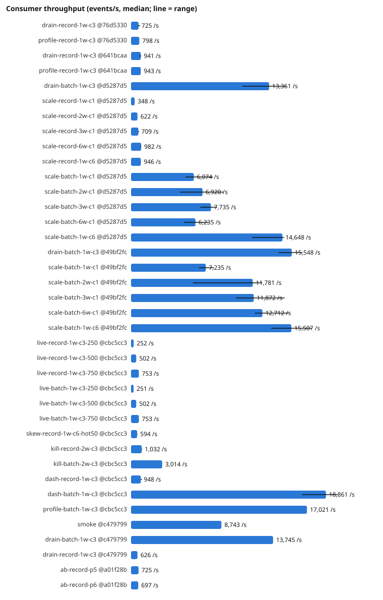
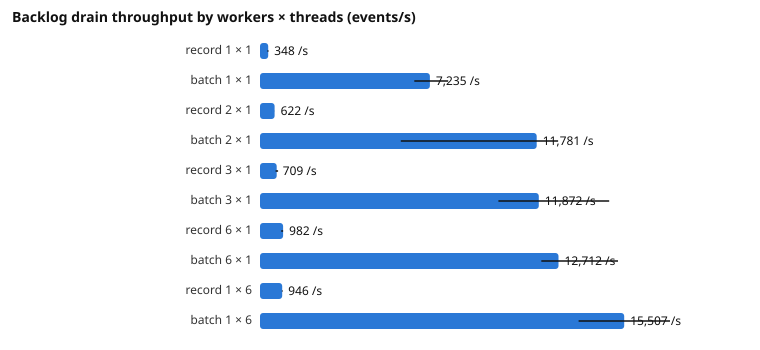

# Benchmark results (generated)

Generated by `python benchmarks/analyze.py` from the raw results in `benchmarks/results/`. Do not edit by
hand. Values are medians over the repetitions with the range (min–max) in brackets; *n* is the number of
repetitions that reconciled as PASS. Methodology and interpretation: [methodology.md](methodology.md),
[README.md](README.md).

## Throughput, latency and accounting

| Scenario | n | Mode | Workers × consumers | Producer acked/s | Consumer processed/s | Drain s | Latency p50 / p95 / p99 ms | Processed | Duplicates |
|---|---|---|---|---|---|---|---|---|---|
| `drain-record-1w-c3 @76d5330` | 5 | RECORD | 1 × 3 | 22,695 (19,573–27,079) | 725 (654–869) | 82.8 (69.1–91.7) | 51,699 (45,192–70,103) / 87,114 (73,053–100,072) / 90,858 (76,316–103,445) | 60,000 | 0 |
| `profile-record-1w-c3 @76d5330` | 1 | RECORD | 1 × 3 | 28,983 | 798 | 75.2 | 50,087 / 80,621 / 83,632 | 60,000 | 0 |
| `drain-record-1w-c3 @641bcaa` | 5 | RECORD | 1 × 3 | 27,127 (13,690–29,538) | 941 (783–983) | 63.7 (61.0–76.6) | 44,586 (43,528–51,344) / 68,605 (65,983–79,834) / 71,335 (68,373–84,061) | 60,000 | 0 |
| `profile-record-1w-c3 @641bcaa` | 1 | RECORD | 1 × 3 | 16,444 | 943 | 63.7 | 45,381 / 69,204 / 71,731 | 60,000 | 0 |
| `drain-batch-1w-c3 @d5287d5` | 3 | BATCH | 1 × 3 | 24,633 (23,370–26,403) | 13,361 (10,774–15,015) | 4.5 (4.0–5.6) | 12,937 (12,667–15,795) / 13,418 (13,268–16,468) / 13,628 (13,397–16,644) | 60,000 | 0 |
| `scale-record-1w-c1 @d5287d5` | 3 | RECORD | 1 × 1 | 16,697 (13,229–20,223) | 348 (314–361) | 172.4 (166.1–191.0) | 99,971 (95,989–109,092) / 171,710 (168,383–193,667) / 178,910 (174,570–199,802) | 60,000 | 0 |
| `scale-record-2w-c1 @d5287d5` | 3 | RECORD | 2 × 1 | 20,082 (15,873–23,867) | 622 (620–624) | 96.4 (96.1–96.7) | 63,807 (61,567–67,487) / 102,216 (101,344–103,688) / 106,655 (106,356–108,152) | 60,000 | 0 |
| `scale-record-3w-c1 @d5287d5` | 3 | RECORD | 3 × 1 | 21,964 (15,224–22,047) | 709 (665–773) | 84.6 (77.6–90.2) | 64,448 (59,378–67,991) / 94,981 (86,170–99,770) / 99,768 (89,976–102,854) | 60,000 | 0 |
| `scale-record-6w-c1 @d5287d5` | 3 | RECORD | 6 × 1 | 19,524 (16,386–26,252) | 982 (902–983) | 61.1 (61.0–66.5) | 64,759 (62,013–66,985) / 85,211 (81,757–85,265) / 87,716 (84,833–88,095) | 60,000 | 0 |
| `scale-record-1w-c6 @d5287d5` | 3 | RECORD | 1 × 6 | 22,575 (19,948–29,013) | 946 (932–964) | 63.4 (62.2–64.4) | 41,467 (39,938–44,192) / 68,952 (67,393–69,287) / 71,086 (69,598–71,694) | 60,000 | 0 |
| `scale-batch-1w-c1 @d5287d5` | 3 | BATCH | 1 × 1 | 31,746 (18,907–33,614) | 6,074 (5,287–7,906) | 9.9 (7.6–11.3) | 15,320 (13,854–19,788) / 18,911 (16,183–24,207) / 19,446 (16,487–24,635) | 60,000 | 0 |
| `scale-batch-2w-c1 @d5287d5` | 3 | BATCH | 2 × 1 | 14,223 (9,493–14,338) | 6,920 (4,751–8,929) | 8.7 (6.7–12.6) | 22,159 (16,149–32,566) / 25,402 (18,858–38,214) / 26,112 (19,406–38,402) | 60,000 | 0 |
| `scale-batch-3w-c1 @d5287d5` | 3 | BATCH | 3 × 1 | 17,951 (17,591–18,155) | 7,735 (6,705–8,329) | 7.8 (7.2–8.9) | 21,243 (19,875–21,985) / 23,930 (21,757–24,302) / 24,051 (22,467–24,736) | 60,000 | 0 |
| `scale-batch-6w-c1 @d5287d5` | 3 | BATCH | 6 × 1 | 20,340 (14,621–21,397) | 6,235 (5,115–7,512) | 9.6 (8.0–11.7) | 31,591 (27,816–34,108) / 33,546 (30,658–35,560) / 33,727 (30,834–35,758) | 60,000 | 0 |
| `scale-batch-1w-c6 @d5287d5` | 3 | BATCH | 1 × 6 | 18,547 (13,179–28,675) | 14,648 (11,721–14,814) | 4.1 (4.1–5.1) | 13,082 (11,710–13,731) / 13,528 (12,769–14,513) / 13,598 (12,860–14,743) | 60,000 | 0 |
| `drain-batch-1w-c3 @49bf2fc` | 3 | BATCH | 1 × 3 | 63,247 (61,679–69,683) | 15,548 (14,276–16,598) | 30.9 (28.9–33.6) | 28,561 (27,772–31,229) / 39,171 (37,810–41,888) / 39,950 (38,705–42,931) | 480,000 | 0 |
| `scale-batch-1w-c1 @49bf2fc` | 3 | BATCH | 1 × 1 | 58,951 (33,371–66,227) | 7,235 (6,569–8,013) | 66.3 (59.9–73.1) | 40,371 (40,149–58,750) / 72,206 (65,534–85,121) / 74,589 (67,920–87,245) | 480,000 | 0 |
| `scale-batch-2w-c1 @49bf2fc` | 3 | BATCH | 2 × 1 | 52,126 (39,604–58,802) | 11,781 (5,995–12,692) | 40.7 (37.8–80.1) | 38,985 (35,897–59,421) / 51,359 (47,190–95,520) / 53,246 (49,960–97,684) | 480,000 | 0 |
| `scale-batch-3w-c1 @49bf2fc` | 3 | BATCH | 3 × 1 | 36,811 (24,373–51,810) | 11,872 (10,153–14,869) | 40.4 (32.3–47.3) | 48,642 (38,783–52,259) / 56,983 (47,268–63,608) / 57,934 (47,901–65,045) | 480,000 | 0 |
| `scale-batch-6w-c1 @49bf2fc` | 3 | BATCH | 6 × 1 | 55,065 (48,167–64,012) | 12,712 (11,979–15,246) | 37.8 (31.5–40.1) | 48,599 (46,194–51,348) / 60,156 (54,102–61,775) / 61,305 (54,960–63,324) | 480,000 | 0 |
| `scale-batch-1w-c6 @49bf2fc` | 3 | BATCH | 1 × 6 | 65,588 (63,947–74,585) | 15,507 (13,567–17,459) | 31.0 (27.5–35.4) | 31,446 (28,023–34,781) / 41,784 (35,660–43,140) / 42,325 (36,258–43,891) | 480,000 | 0 |
| `live-record-1w-c3-250 @cbc5cc3` | 3 | RECORD | 1 × 3 | 250 (250–250) | 252 (251–252) | 59.6 (59.5–59.7) | 7 (7–7) / 33 (13–78) / 456 (118–535) | 15,000 | 0 |
| `live-record-1w-c3-500 @cbc5cc3` | 3 | RECORD | 1 × 3 | 500 (499–500) | 502 (502–509) | 59.7 (58.9–59.8) | 7 (7–7) / 548 (120–1,620) / 1,462 (499–2,223) | 30,000 | 0 |
| `live-record-1w-c3-750 @cbc5cc3` | 3 | RECORD | 1 × 3 | 749 (749–750) | 753 (753–754) | 59.7 (59.7–59.7) | 10 (10–15) / 1,103 (844–1,191) / 1,555 (1,157–1,735) | 45,000 | 0 |
| `live-batch-1w-c3-250 @cbc5cc3` | 3 | BATCH | 1 × 3 | 250 (250–250) | 251 (251–251) | 59.7 (59.7–59.8) | 7 (7–7) / 23 (20–25) / 395 (335–461) | 15,000 | 0 |
| `live-batch-1w-c3-500 @cbc5cc3` | 3 | BATCH | 1 × 3 | 500 (500–500) | 502 (502–502) | 59.7 (59.7–59.8) | 6 (6–6) / 28 (23–29) / 361 (234–503) | 30,000 | 0 |
| `live-batch-1w-c3-750 @cbc5cc3` | 3 | BATCH | 1 × 3 | 748 (748–749) | 753 (753–754) | 59.7 (59.7–59.8) | 7 (6–7) / 54 (50–7,721) / 558 (557–9,771) | 45,000 | 0 |
| `skew-record-1w-c6-hot50 @cbc5cc3` | 3 | RECORD | 1 × 6 | 15,621 (14,001–27,509) | 594 (585–619) | 101.0 (96.9–102.6) | 40,221 (36,825–41,471) / 103,346 (97,507–104,223) / 109,178 (103,532–109,648) | 60,000 | 0 |
| `kill-record-2w-c3 @cbc5cc3` | 3 | RECORD | 2 × 3 | 18,465 (14,046–25,161) | 1,032 (1,031–1,090) | 58.1 (55.1–58.2) | 36,654 (34,587–37,520) / 64,162 (63,177–64,509) / 66,827 (65,770–67,337) | 60,000 | 837 (573–1,359) |
| `kill-batch-2w-c3 @cbc5cc3` | 3 | BATCH | 2 × 3 | 2,986 (2,976–2,997) | 3,014 (3,012–3,018) | 59.7 (59.7–59.8) | 21 (19–26) / 7,525 (7,017–7,823) / 11,517 (11,159–12,063) | 180,000 | 15 (1–144) |
| `dash-record-1w-c3 @cbc5cc3` | 3 | RECORD | 1 × 3 | 18,418 (8,261–20,753) | 948 (941–1,068) | 63.3 (56.2–63.8) | 39,914 (39,778–48,816) / 66,928 (60,239–70,643) / 69,822 (63,759–74,602) | 60,000 | 0 |
| `dash-batch-1w-c3 @cbc5cc3` | 3 | BATCH | 1 × 3 | 45,590 (44,200–46,413) | 18,861 (16,554–19,990) | 25.4 (24.0–29.0) | 27,286 (24,908–32,131) / 34,067 (32,024–38,549) / 34,776 (32,783–39,037) | 480,000 | 0 |
| `profile-batch-1w-c3 @cbc5cc3` | 1 | BATCH | 1 × 3 | 60,108 | 17,021 | 28.2 | 27,813 / 37,032 / 37,978 | 480,000 | 0 |

## Database work per run

| Scenario | Transactions committed | WAL fsyncs (client) | WAL fsync time ms | Statement time ms | Events per transaction |
|---|---|---|---|---|---|
| `drain-record-1w-c3 @76d5330` | 60,080 (59,675–60,295) | 48,637 (47,278–50,859) | 52,438 (45,170–57,414) | 32,285 (26,507–36,771) | 1.0 (1.0–1.0) |
| `profile-record-1w-c3 @76d5330` | 60,232 | 47,776 | 48,311 | 29,300 | 1.0 |
| `drain-record-1w-c3 @641bcaa` | 59,985 (59,624–60,251) | 49,023 (48,727–49,304) | 46,095 (45,046–53,741) | 25,101 (22,803–32,358) | 1.0 (1.0–1.0) |
| `profile-record-1w-c3 @641bcaa` | 60,065 | 48,858 | 46,235 | 25,825 | 1.0 |
| `drain-batch-1w-c3 @d5287d5` | 220 (220–228) | 86 (83–100) | 197 (192–220) | 6,016 (5,038–6,230) | 272.7 (263.2–272.7) |
| `scale-record-1w-c1 @d5287d5` | 60,737 (60,494–60,777) | 60,017 (59,798–60,057) | 62,294 (58,876–67,612) | 28,320 (27,879–30,881) | 1.0 (1.0–1.0) |
| `scale-record-2w-c1 @d5287d5` | 60,269 (60,001–60,665) | 59,586 (59,320–59,943) | 59,910 (57,638–60,286) | 26,560 (25,294–27,213) | 1.0 (1.0–1.0) |
| `scale-record-3w-c1 @d5287d5` | 60,403 (60,032–60,534) | 49,359 (49,203–49,867) | 58,070 (52,460–60,355) | 31,318 (29,277–33,196) | 1.0 (1.0–1.0) |
| `scale-record-6w-c1 @d5287d5` | 60,365 (59,786–60,383) | 30,391 (30,373–30,875) | 40,750 (40,139–47,111) | 39,691 (39,183–43,901) | 1.0 (1.0–1.0) |
| `scale-record-1w-c6 @d5287d5` | 60,005 (59,904–60,227) | 48,700 (48,355–49,052) | 45,621 (44,618–46,713) | 26,813 (26,591–27,081) | 1.0 (1.0–1.0) |
| `scale-batch-1w-c1 @d5287d5` | 229 (224–234) | 129 (129–133) | 330 (205–359) | 5,157 (3,144–5,910) | 262.0 (256.4–267.9) |
| `scale-batch-2w-c1 @d5287d5` | 304 (284–311) | 129 (123–137) | 275 (271–326) | 8,602 (6,109–8,920) | 197.4 (192.9–211.3) |
| `scale-batch-3w-c1 @d5287d5` | 338 (313–352) | 130 (126–142) | 287 (254–373) | 6,969 (6,863–8,667) | 177.5 (170.5–191.7) |
| `scale-batch-6w-c1 @d5287d5` | 510 (502–512) | 136 (119–136) | 518 (443–530) | 17,716 (15,026–22,896) | 117.6 (117.2–119.5) |
| `scale-batch-1w-c6 @d5287d5` | 220 (207–222) | 86 (75–87) | 147 (128–211) | 5,508 (5,104–7,572) | 272.7 (270.3–289.9) |
| `drain-batch-1w-c3 @49bf2fc` | 1,172 (1,147–1,186) | 883 (854–905) | 2,666 (2,324–2,908) | 52,270 (51,983–53,862) | 409.6 (404.7–418.5) |
| `scale-batch-1w-c1 @49bf2fc` | 1,342 (1,327–1,368) | 1,024 (1,023–1,025) | 2,081 (1,952–2,815) | 44,709 (39,098–48,356) | 357.7 (350.9–361.7) |
| `scale-batch-2w-c1 @49bf2fc` | 1,334 (1,280–1,534) | 1,028 (1,008–1,046) | 2,422 (1,719–3,735) | 47,466 (43,409–106,017) | 359.8 (312.9–375.0) |
| `scale-batch-3w-c1 @49bf2fc` | 1,377 (1,323–1,452) | 883 (854–919) | 2,619 (2,011–2,805) | 63,287 (52,928–77,376) | 348.6 (330.6–362.8) |
| `scale-batch-6w-c1 @49bf2fc` | 1,594 (1,555–1,603) | 855 (805–867) | 3,391 (3,087–3,612) | 100,036 (89,801–110,386) | 301.1 (299.4–308.7) |
| `scale-batch-1w-c6 @49bf2fc` | 1,186 (1,135–1,197) | 849 (835–883) | 1,949 (1,780–2,603) | 52,054 (47,789–60,963) | 404.7 (401.0–422.9) |
| `live-record-1w-c3-250 @cbc5cc3` | 15,203 (15,197–15,204) | 14,355 (14,336–14,389) | 14,383 (12,535–15,185) | 7,726 (7,688–8,484) | 1.0 (1.0–1.0) |
| `live-record-1w-c3-500 @cbc5cc3` | 30,184 (30,126–30,210) | 26,852 (26,537–27,219) | 25,634 (24,713–28,214) | 14,554 (14,189–16,214) | 1.0 (1.0–1.0) |
| `live-record-1w-c3-750 @cbc5cc3` | 45,201 (45,200–45,209) | 39,535 (38,290–39,556) | 33,554 (33,013–36,043) | 20,208 (19,482–20,242) | 1.0 (1.0–1.0) |
| `live-batch-1w-c3-250 @cbc5cc3` | 12,224 (12,188–12,293) | 11,616 (11,569–11,700) | 12,111 (12,060–12,263) | 10,766 (10,575–10,994) | 1.2 (1.2–1.2) |
| `live-batch-1w-c3-500 @cbc5cc3` | 20,113 (19,885–20,287) | 17,722 (17,538–17,764) | 17,012 (16,912–17,627) | 17,930 (17,692–18,442) | 1.5 (1.5–1.5) |
| `live-batch-1w-c3-750 @cbc5cc3` | 23,523 (19,295–23,549) | 19,486 (15,818–19,529) | 20,434 (14,333–20,621) | 23,181 (19,236–23,787) | 1.9 (1.9–2.3) |
| `skew-record-1w-c6-hot50 @cbc5cc3` | 60,417 (60,137–60,447) | 54,009 (53,985–54,542) | 47,568 (43,342–49,607) | 24,301 (24,120–25,142) | 1.0 (1.0–1.0) |
| `kill-record-2w-c3 @cbc5cc3` | 61,047 (60,368–61,114) | 40,995 (40,765–42,458) | 39,360 (37,899–39,752) | 29,126 (27,607–30,237) | 1.0 (1.0–1.0) |
| `kill-batch-2w-c3 @cbc5cc3` | 26,239 (21,251–28,264) | 17,517 (14,702–18,428) | 23,334 (20,360–23,608) | 54,693 (51,737–56,339) | 6.9 (6.4–8.5) |
| `dash-record-1w-c3 @cbc5cc3` | 60,664 (60,575–60,665) | 49,126 (48,074–50,258) | 42,924 (39,598–44,467) | 26,490 (24,292–28,057) | 1.0 (1.0–1.0) |
| `dash-batch-1w-c3 @cbc5cc3` | 1,597 (1,568–1,609) | 844 (804–892) | 1,902 (1,459–2,160) | 48,154 (45,687–49,711) | 300.6 (298.3–306.1) |
| `profile-batch-1w-c3 @cbc5cc3` | 1,163 | 873 | 1,428 | 49,372 | 412.7 |

## Container resources while events were processed

CPU is in percent of one core (Docker stats, about one sample per second); memory is the peak.

| Scenario | Worker CPU mean / peak | PostgreSQL CPU mean / peak | Kafka CPU mean | Worker memory peak MiB | PostgreSQL memory peak MiB |
|---|---|---|---|---|---|
| `drain-record-1w-c3 @76d5330` | 82 (77–86) / 204 (181–259) | 115 (110–118) / 147 (128–186) | 10 (8–15) | 274 (267–282) | 86 (83–90) |
| `profile-record-1w-c3 @76d5330` | 85 / 295 | 114 / 143 | 7 | 315 | 85 |
| `drain-record-1w-c3 @641bcaa` | 63 (61–67) / 168 (149–205) | 109 (107–114) / 130 (121–134) | 11 (6–15) | 273 (270–281) | 86 (81–89) |
| `profile-record-1w-c3 @641bcaa` | 69 / 190 | 108 / 128 | 10 | 307 | 85 |
| `drain-batch-1w-c3 @d5287d5` | 156 (123–179) / 179 (123–310) | 87 (6–180) / 168 (6–180) | 15 (11–21) | 255 (247–270) | 81 (81–81) |
| `scale-record-1w-c1 @d5287d5` | 30 (29–34) / 123 (92–136) | 47 (46–49) / 115 (82–118) | 8 (7–8) | 240 (235–242) | 88 (88–90) |
| `scale-record-2w-c1 @d5287d5` | 68 (67–69) / 210 (165–212) | 77 (76–80) / 98 (91–105) | 9 (9–10) | 458 (451–465) | 93 (91–97) |
| `scale-record-3w-c1 @d5287d5` | 122 (116–125) / 270 (244–293) | 101 (101–104) / 121 (120–175) | 10 (9–15) | 671 (652–679) | 99 (99–100) |
| `scale-record-6w-c1 @d5287d5` | 286 (280–321) / 603 (450–603) | 168 (158–176) / 221 (209–223) | 14 (12–18) | 1,266 (1,256–1,280) | 126 (126–129) |
| `scale-record-1w-c6 @d5287d5` | 79 (74–86) / 254 (187–277) | 115 (108–119) / 144 (132–152) | 8 (7–10) | 285 (285–287) | 105 (96–105) |
| `scale-batch-1w-c1 @d5287d5` | 54 (35–83) / 118 (76–205) | 54 (52–56) / 78 (71–81) | 7 (7–11) | 232 (230–234) | 94 (94–96) |
| `scale-batch-2w-c1 @d5287d5` | 97 (58–189) / 190 (112–327) | 95 (59–128) / 129 (119–175) | 10 (8–20) | 461 (440–465) | 100 (97–109) |
| `scale-batch-3w-c1 @d5287d5` | 208 (208–334) / 411 (284–485) | 91 (90–110) / 180 (126–181) | 27 (9–27) | 674 (671–684) | 103 (103–104) |
| `scale-batch-6w-c1 @d5287d5` | 462 (433–635) / 747 (747–933) | 140 (120–237) / 244 (236–249) | 37 (10–39) | 1,235 (1,229–1,253) | 124 (122–126) |
| `scale-batch-1w-c6 @d5287d5` | 199 (128–273) / 246 (199–273) | 153 (98–185) / 185 (153–194) | 12 (10–19) | 296 (291–299) | 94 (93–94) |
| `drain-batch-1w-c3 @49bf2fc` | 97 (86–105) / 281 (277–295) | 177 (163–190) / 216 (201–232) | 19 (12–76) | 280 (278–306) | 341 (307–342) |
| `scale-batch-1w-c1 @49bf2fc` | 35 (31–38) / 122 (86–157) | 78 (77–80) / 99 (84–133) | 9 (7–12) | 272 (264–274) | 345 (344–345) |
| `scale-batch-2w-c1 @49bf2fc` | 83 (76–95) / 263 (258–276) | 127 (124–168) / 155 (147–311) | 14 (10–33) | 502 (488–508) | 349 (349–355) |
| `scale-batch-3w-c1 @49bf2fc` | 137 (125–173) / 404 (356–560) | 186 (182–191) / 263 (216–298) | 21 (15–24) | 724 (710–725) | 356 (356–357) |
| `scale-batch-6w-c1 @49bf2fc` | 358 (321–374) / 759 (715–801) | 269 (256–289) / 388 (378–408) | 25 (25–26) | 1,328 (1,325–1,336) | 383 (382–395) |
| `scale-batch-1w-c6 @49bf2fc` | 101 (66–117) / 246 (243–328) | 205 (134–211) / 238 (225–244) | 11 (11–51) | 295 (292–307) | 352 (346–359) |
| `live-record-1w-c3-250 @cbc5cc3` | 47 (45–49) / 120 (116–122) | 28 (27–29) / 37 (35–38) | 35 (34–41) | 223 (219–228) | 338 (333–340) |
| `live-record-1w-c3-500 @cbc5cc3` | 72 (62–78) / 197 (175–198) | 59 (53–64) / 96 (76–110) | 53 (48–55) | 225 (223–227) | 337 (336–338) |
| `live-record-1w-c3-750 @cbc5cc3` | 80 (76–81) / 186 (155–209) | 81 (80–82) / 108 (103–115) | 51 (49–52) | 226 (225–229) | 341 (340–343) |
| `live-batch-1w-c3-250 @cbc5cc3` | 52 (44–58) / 117 (87–121) | 43 (41–47) / 56 (56–70) | 38 (37–40) | 222 (220–223) | 343 (343–344) |
| `live-batch-1w-c3-500 @cbc5cc3` | 75 (74–76) / 181 (165–203) | 70 (65–71) / 80 (74–96) | 48 (47–52) | 222 (222–222) | 344 (342–344) |
| `live-batch-1w-c3-750 @cbc5cc3` | 87 (87–89) / 227 (184–231) | 80 (71–88) / 117 (99–122) | 61 (58–71) | 227 (222–245) | 342 (342–343) |
| `skew-record-1w-c6-hot50 @cbc5cc3` | 46 (44–47) / 218 (173–238) | 69 (68–69) / 127 (124–132) | 7 (7–7) | 276 (272–279) | 343 (342–350) |
| `kill-record-2w-c3 @cbc5cc3` | 170 (142–187) / 372 (319–571) | 135 (132–139) / 226 (216–229) | 10 (6–11) | 498 (492–501) | 354 (349–358) |
| `kill-batch-2w-c3 @cbc5cc3` | 252 (244–274) / 454 (438–506) | 175 (141–185) / 251 (240–334) | 84 (84–84) | 474 (471–491) | 355 (353–356) |
| `dash-record-1w-c3 @cbc5cc3` | 57 (53–67) / 145 (112–155) | 118 (111–123) / 135 (127–143) | 8 (6–9) | 275 (272–275) | 356 (356–362) |
| `dash-batch-1w-c3 @cbc5cc3` | 72 (64–83) / 157 (108–223) | 185 (181–205) / 221 (217–269) | 10 (9–13) | 280 (279–281) | 363 (363–365) |
| `profile-batch-1w-c3 @cbc5cc3` | 78 / 125 | 173 / 213 | 14 | 316 | 352 |

## Partition distribution

Skew = events on the busiest partition ÷ mean events per partition (1.0 = perfectly even).

| Scenario | Skew | Events per partition (first repetition) |
|---|---|---|
| `drain-record-1w-c3 @76d5330` | 1.06 | 9875, 9611, 9985, 10113, 9850, 10566 |
| `profile-record-1w-c3 @76d5330` | 1.06 | 9875, 9611, 9985, 10113, 9850, 10566 |
| `drain-record-1w-c3 @641bcaa` | 1.06 | 9875, 9611, 9985, 10113, 9850, 10566 |
| `profile-record-1w-c3 @641bcaa` | 1.06 | 9875, 9611, 9985, 10113, 9850, 10566 |
| `drain-batch-1w-c3 @d5287d5` | 1.06 | 9875, 9611, 9985, 10113, 9850, 10566 |
| `scale-record-1w-c1 @d5287d5` | 1.06 | 9875, 9611, 9985, 10113, 9850, 10566 |
| `scale-record-2w-c1 @d5287d5` | 1.06 | 9875, 9611, 9985, 10113, 9850, 10566 |
| `scale-record-3w-c1 @d5287d5` | 1.06 | 9875, 9611, 9985, 10113, 9850, 10566 |
| `scale-record-6w-c1 @d5287d5` | 1.06 | 9875, 9611, 9985, 10113, 9850, 10566 |
| `scale-record-1w-c6 @d5287d5` | 1.06 | 9875, 9611, 9985, 10113, 9850, 10566 |
| `scale-batch-1w-c1 @d5287d5` | 1.06 | 9875, 9611, 9985, 10113, 9850, 10566 |
| `scale-batch-2w-c1 @d5287d5` | 1.06 | 9875, 9611, 9985, 10113, 9850, 10566 |
| `scale-batch-3w-c1 @d5287d5` | 1.06 | 9875, 9611, 9985, 10113, 9850, 10566 |
| `scale-batch-6w-c1 @d5287d5` | 1.06 | 9875, 9611, 9985, 10113, 9850, 10566 |
| `scale-batch-1w-c6 @d5287d5` | 1.06 | 9875, 9611, 9985, 10113, 9850, 10566 |
| `drain-batch-1w-c3 @49bf2fc` | 1.05 | 79359, 76905, 79892, 80827, 79256, 83761 |
| `scale-batch-1w-c1 @49bf2fc` | 1.05 | 79359, 76905, 79892, 80827, 79256, 83761 |
| `scale-batch-2w-c1 @49bf2fc` | 1.05 | 79359, 76905, 79892, 80827, 79256, 83761 |
| `scale-batch-3w-c1 @49bf2fc` | 1.05 | 79359, 76905, 79892, 80827, 79256, 83761 |
| `scale-batch-6w-c1 @49bf2fc` | 1.05 | 79359, 76905, 79892, 80827, 79256, 83761 |
| `scale-batch-1w-c6 @49bf2fc` | 1.05 | 79359, 76905, 79892, 80827, 79256, 83761 |
| `live-record-1w-c3-250 @cbc5cc3` | 1.10 | 2502, 2377, 2427, 2512, 2433, 2749 |
| `live-record-1w-c3-500 @cbc5cc3` | 1.07 | 4984, 4704, 4931, 5089, 4963, 5329 |
| `live-record-1w-c3-750 @cbc5cc3` | 1.06 | 7448, 7144, 7408, 7636, 7418, 7946 |
| `live-batch-1w-c3-250 @cbc5cc3` | 1.10 | 2502, 2377, 2427, 2512, 2433, 2749 |
| `live-batch-1w-c3-500 @cbc5cc3` | 1.07 | 4984, 4704, 4931, 5089, 4963, 5329 |
| `live-batch-1w-c3-750 @cbc5cc3` | 1.06 | 7448, 7144, 7408, 7636, 7418, 7946 |
| `skew-record-1w-c6-hot50 @cbc5cc3` | 3.45 | 5063, 34478, 5121, 5085, 4982, 5271 |
| `kill-record-2w-c3 @cbc5cc3` | 1.06 | 9875, 9611, 9985, 10113, 9850, 10566 |
| `kill-batch-2w-c3 @cbc5cc3` | 1.05 | 29583, 28650, 29953, 30416, 29819, 31579 |
| `dash-record-1w-c3 @cbc5cc3` | 1.06 | 9875, 9611, 9985, 10113, 9850, 10566 |
| `dash-batch-1w-c3 @cbc5cc3` | 1.05 | 79359, 76905, 79892, 80827, 79256, 83761 |
| `profile-batch-1w-c3 @cbc5cc3` | 1.05 | 79359, 76905, 79892, 80827, 79256, 83761 |

## Worker kill and recovery

One of two workers is killed (SIGKILL) and restarted 15 s later. *Partition stall* is the longest time any
partition's lag stopped falling after the kill, from the lag timeline (backlog runs only: in live runs the
timeline starts after publishing and does not cover the kill). *Max latency* is the longest any event
waited from its Kafka append to processing.

| Scenario | Workload | Partition stall s | Max latency ms | p99 ms | Duplicates suppressed | Result |
|---|---|---|---|---|---|---|
| `kill-record-2w-c3 @cbc5cc3` | backlog | 18.5 (15.9–19.9) | 68,305 (66,801–68,368) | 66,827 (65,770–67,337) | 837 (573–1,359) | 3 × PASS |
| `kill-batch-2w-c3 @cbc5cc3` | live | n/a | 12,645 (12,253–13,132) | 11,517 (11,159–12,063) | 15 (1–144) | 3 × PASS |

## Top statements (first repetition of each scenario)

**`drain-record-1w-c3 @76d5330`**

| Total ms | Calls | Mean ms | Statement |
|---|---|---|---|
| 6,171 | 60,000 | 0.103 | `INSERT INTO latency_stats_minute (bucket_start, kafka_partition, bucket_index, event_count) SELECT date_trunc(` |
| 6,040 | 60,000 | 0.101 | `INSERT INTO processed_events (event_id, run_id, run_seq, kafka_partition, kafka_offset) VALUES ($1, $2, $3, $4` |
| 5,035 | 60,000 | 0.084 | `INSERT INTO event_stats_minute (bucket_start, event_type, kafka_partition, event_count, amount_cents) VALUES (` |
| 4,510 | 58,553 | 0.077 | `INSERT INTO events (event_id, event_type, occurred_at, kafka_ts, kafka_partition, kafka_offset, run_id, run_se` |
| 4,304 | 60,000 | 0.072 | `INSERT INTO run_stats (run_id, kafka_partition, processed, duplicates_suppressed) VALUES ($1, $2, $3, $4) ON C` |
| 106 | 1,447 | 0.073 | `INSERT INTO events (event_id, event_type, occurred_at, kafka_ts, kafka_partition, kafka_offset, run_id, run_se` |

**`profile-record-1w-c3 @76d5330`**

| Total ms | Calls | Mean ms | Statement |
|---|---|---|---|
| 6,948 | 60,000 | 0.116 | `INSERT INTO processed_events (event_id, run_id, run_seq, kafka_partition, kafka_offset) VALUES ($1, $2, $3, $4` |
| 6,315 | 60,000 | 0.105 | `INSERT INTO latency_stats_minute (bucket_start, kafka_partition, bucket_index, event_count) SELECT date_trunc(` |
| 5,838 | 58,553 | 0.100 | `INSERT INTO events (event_id, event_type, occurred_at, kafka_ts, kafka_partition, kafka_offset, run_id, run_se` |
| 5,263 | 60,000 | 0.088 | `INSERT INTO event_stats_minute (bucket_start, event_type, kafka_partition, event_count, amount_cents) VALUES (` |
| 4,449 | 60,000 | 0.074 | `INSERT INTO run_stats (run_id, kafka_partition, processed, duplicates_suppressed) VALUES ($1, $2, $3, $4) ON C` |
| 137 | 1,447 | 0.095 | `INSERT INTO events (event_id, event_type, occurred_at, kafka_ts, kafka_partition, kafka_offset, run_id, run_se` |

**`drain-record-1w-c3 @641bcaa`**

| Total ms | Calls | Mean ms | Statement |
|---|---|---|---|
| 16,345 | 58,553 | 0.279 | `WITH event_row AS ( INSERT INTO events (event_id, event_type, occurred_at, kafka_ts, kafka_partition, kafka_of` |
| 5,710 | 60,000 | 0.095 | `INSERT INTO processed_events (event_id, run_id, run_seq, kafka_partition, kafka_offset) VALUES ($1, $2, $3, $4` |
| 340 | 1,447 | 0.235 | `WITH event_row AS ( INSERT INTO events (event_id, event_type, occurred_at, kafka_ts, kafka_partition, kafka_of` |
| 187 | 1 | 187.296 | `WITH sink AS ( SELECT run_seq FROM processed_events WHERE run_id = $1 UNION SELECT run_seq FROM dead_letter_ev` |
| 58 | 1 | 57.918 | `SELECT count(*) FROM ( SELECT run_seq FROM ( SELECT run_seq, event_id FROM processed_events WHERE run_id = $1 ` |
| 42 | 1 | 41.493 | `WITH l AS (SELECT extract($2 FROM ingested_at - kafka_ts) * $3 AS ms FROM events WHERE run_id = $1) SELECT cou` |

**`profile-record-1w-c3 @641bcaa`**

| Total ms | Calls | Mean ms | Statement |
|---|---|---|---|
| 18,439 | 58,553 | 0.315 | `WITH event_row AS ( INSERT INTO events (event_id, event_type, occurred_at, kafka_ts, kafka_partition, kafka_of` |
| 6,668 | 60,000 | 0.111 | `INSERT INTO processed_events (event_id, run_id, run_seq, kafka_partition, kafka_offset) VALUES ($1, $2, $3, $4` |
| 397 | 1,447 | 0.274 | `WITH event_row AS ( INSERT INTO events (event_id, event_type, occurred_at, kafka_ts, kafka_partition, kafka_of` |
| 105 | 1 | 105.158 | `WITH sink AS ( SELECT run_seq FROM processed_events WHERE run_id = $1 UNION SELECT run_seq FROM dead_letter_ev` |
| 49 | 1 | 48.992 | `SELECT count(*) FROM ( SELECT run_seq FROM ( SELECT run_seq, event_id FROM processed_events WHERE run_id = $1 ` |
| 41 | 1 | 40.877 | `WITH l AS (SELECT extract($2 FROM ingested_at - kafka_ts) * $3 AS ms FROM events WHERE run_id = $1) SELECT cou` |

**`drain-batch-1w-c3 @d5287d5`**

| Total ms | Calls | Mean ms | Statement |
|---|---|---|---|
| 3,015 | 123 | 24.515 | `INSERT INTO processed_events (event_id, run_id, run_seq, kafka_partition, kafka_offset) SELECT * FROM unnest($` |
| 2,047 | 123 | 16.642 | `INSERT INTO events (event_id, event_type, occurred_at, kafka_ts, kafka_partition, kafka_offset, run_id, run_se` |
| 614 | 123 | 4.995 | `WITH sample AS ( SELECT p, (SELECT count(*) FROM unnest(ARRAY[$1 /*, ... */]::bigint[]) AS bound WHERE bound <` |
| 52 | 1 | 51.743 | `SELECT count(*) FROM generate_series($5, $1) AS s WHERE NOT EXISTS (SELECT $6 FROM processed_events p WHERE p.` |
| 50 | 1 | 49.610 | `WITH l AS (SELECT extract($2 FROM ingested_at - kafka_ts) * $3 AS ms FROM events WHERE run_id = $1) SELECT cou` |
| 49 | 123 | 0.397 | `INSERT INTO event_stats_minute (bucket_start, event_type, kafka_partition, event_count, amount_cents) SELECT d` |

**`scale-record-1w-c1 @d5287d5`**

| Total ms | Calls | Mean ms | Statement |
|---|---|---|---|
| 19,236 | 58,553 | 0.329 | `WITH event_row AS ( INSERT INTO events (event_id, event_type, occurred_at, kafka_ts, kafka_partition, kafka_of` |
| 7,929 | 60,000 | 0.132 | `INSERT INTO processed_events (event_id, run_id, run_seq, kafka_partition, kafka_offset) VALUES ($1, $2, $3, $4` |
| 435 | 1,447 | 0.300 | `WITH event_row AS ( INSERT INTO events (event_id, event_type, occurred_at, kafka_ts, kafka_partition, kafka_of` |
| 230 | 1 | 230.338 | `SELECT count(*) FROM ( SELECT run_seq FROM ( SELECT run_seq, event_id FROM processed_events WHERE run_id = $1 ` |
| 138 | 1 | 137.894 | `SELECT count(*) FROM generate_series($5, $1) AS s WHERE NOT EXISTS (SELECT $6 FROM processed_events p WHERE p.` |
| 112 | 1 | 112.043 | `WITH sink AS ( SELECT run_seq FROM processed_events WHERE run_id = $1 UNION SELECT run_seq FROM dead_letter_ev` |

**`scale-record-2w-c1 @d5287d5`**

| Total ms | Calls | Mean ms | Statement |
|---|---|---|---|
| 18,744 | 58,553 | 0.320 | `WITH event_row AS ( INSERT INTO events (event_id, event_type, occurred_at, kafka_ts, kafka_partition, kafka_of` |
| 7,035 | 60,000 | 0.117 | `INSERT INTO processed_events (event_id, run_id, run_seq, kafka_partition, kafka_offset) VALUES ($1, $2, $3, $4` |
| 404 | 1,447 | 0.279 | `WITH event_row AS ( INSERT INTO events (event_id, event_type, occurred_at, kafka_ts, kafka_partition, kafka_of` |
| 107 | 1 | 107.057 | `WITH sink AS ( SELECT run_seq FROM processed_events WHERE run_id = $1 UNION SELECT run_seq FROM dead_letter_ev` |
| 63 | 1 | 63.213 | `WITH l AS (SELECT extract($2 FROM ingested_at - kafka_ts) * $3 AS ms FROM events WHERE run_id = $1) SELECT cou` |
| 48 | 1 | 47.855 | `SELECT count(*) FROM ( SELECT run_seq FROM ( SELECT run_seq, event_id FROM processed_events WHERE run_id = $1 ` |

**`scale-record-3w-c1 @d5287d5`**

| Total ms | Calls | Mean ms | Statement |
|---|---|---|---|
| 23,096 | 58,553 | 0.394 | `WITH event_row AS ( INSERT INTO events (event_id, event_type, occurred_at, kafka_ts, kafka_partition, kafka_of` |
| 8,836 | 60,000 | 0.147 | `INSERT INTO processed_events (event_id, run_id, run_seq, kafka_partition, kafka_offset) VALUES ($1, $2, $3, $4` |
| 456 | 1,447 | 0.315 | `WITH event_row AS ( INSERT INTO events (event_id, event_type, occurred_at, kafka_ts, kafka_partition, kafka_of` |
| 223 | 1 | 222.620 | `WITH sink AS ( SELECT run_seq FROM processed_events WHERE run_id = $1 UNION SELECT run_seq FROM dead_letter_ev` |
| 100 | 1 | 99.690 | `SELECT count(*) AS events, min(ingested_at) AS first_at, max(ingested_at) AS last_at, extract($2 FROM max(inge` |
| 78 | 1 | 77.769 | `SELECT count(*) FROM ( SELECT run_seq FROM ( SELECT run_seq, event_id FROM processed_events WHERE run_id = $1 ` |

**`scale-record-6w-c1 @d5287d5`**

| Total ms | Calls | Mean ms | Statement |
|---|---|---|---|
| 31,463 | 58,553 | 0.537 | `WITH event_row AS ( INSERT INTO events (event_id, event_type, occurred_at, kafka_ts, kafka_partition, kafka_of` |
| 11,230 | 60,000 | 0.187 | `INSERT INTO processed_events (event_id, run_id, run_seq, kafka_partition, kafka_offset) VALUES ($1, $2, $3, $4` |
| 601 | 1,447 | 0.415 | `WITH event_row AS ( INSERT INTO events (event_id, event_type, occurred_at, kafka_ts, kafka_partition, kafka_of` |
| 160 | 1 | 160.409 | `SELECT count(*) FROM ( SELECT run_seq FROM ( SELECT run_seq, event_id FROM processed_events WHERE run_id = $1 ` |
| 135 | 1 | 135.046 | `WITH sink AS ( SELECT run_seq FROM processed_events WHERE run_id = $1 UNION SELECT run_seq FROM dead_letter_ev` |
| 83 | 213 | 0.390 | `INSERT INTO worker_heartbeats (worker_id, host, started_at, last_seen_at, processed, duplicates, failures_bad_` |

**`scale-record-1w-c6 @d5287d5`**

| Total ms | Calls | Mean ms | Statement |
|---|---|---|---|
| 19,079 | 58,553 | 0.326 | `WITH event_row AS ( INSERT INTO events (event_id, event_type, occurred_at, kafka_ts, kafka_partition, kafka_of` |
| 6,774 | 60,000 | 0.113 | `INSERT INTO processed_events (event_id, run_id, run_seq, kafka_partition, kafka_offset) VALUES ($1, $2, $3, $4` |
| 402 | 1,447 | 0.278 | `WITH event_row AS ( INSERT INTO events (event_id, event_type, occurred_at, kafka_ts, kafka_partition, kafka_of` |
| 115 | 1 | 114.745 | `WITH sink AS ( SELECT run_seq FROM processed_events WHERE run_id = $1 UNION SELECT run_seq FROM dead_letter_ev` |
| 52 | 1 | 51.741 | `SELECT count(*) FROM ( SELECT run_seq FROM ( SELECT run_seq, event_id FROM processed_events WHERE run_id = $1 ` |
| 46 | 1 | 45.551 | `WITH l AS (SELECT extract($2 FROM ingested_at - kafka_ts) * $3 AS ms FROM events WHERE run_id = $1) SELECT cou` |

**`scale-batch-1w-c1 @d5287d5`**

| Total ms | Calls | Mean ms | Statement |
|---|---|---|---|
| 2,546 | 121 | 21.041 | `INSERT INTO processed_events (event_id, run_id, run_seq, kafka_partition, kafka_offset) SELECT * FROM unnest($` |
| 1,722 | 121 | 14.229 | `INSERT INTO events (event_id, event_type, occurred_at, kafka_ts, kafka_partition, kafka_offset, run_id, run_se` |
| 601 | 121 | 4.969 | `WITH sample AS ( SELECT p, (SELECT count(*) FROM unnest(ARRAY[$1 /*, ... */]::bigint[]) AS bound WHERE bound <` |
| 43 | 1 | 43.215 | `WITH l AS (SELECT extract($2 FROM ingested_at - kafka_ts) * $3 AS ms FROM events WHERE run_id = $1) SELECT cou` |
| 41 | 121 | 0.341 | `INSERT INTO event_stats_minute (bucket_start, event_type, kafka_partition, event_count, amount_cents) SELECT d` |
| 32 | 1 | 31.995 | `SELECT count(*) FROM generate_series($5, $1) AS s WHERE NOT EXISTS (SELECT $6 FROM processed_events p WHERE p.` |

**`scale-batch-2w-c1 @d5287d5`**

| Total ms | Calls | Mean ms | Statement |
|---|---|---|---|
| 4,483 | 122 | 36.749 | `INSERT INTO processed_events (event_id, run_id, run_seq, kafka_partition, kafka_offset) SELECT * FROM unnest($` |
| 3,072 | 122 | 25.182 | `INSERT INTO events (event_id, event_type, occurred_at, kafka_ts, kafka_partition, kafka_offset, run_id, run_se` |
| 857 | 122 | 7.026 | `WITH sample AS ( SELECT p, (SELECT count(*) FROM unnest(ARRAY[$1 /*, ... */]::bigint[]) AS bound WHERE bound <` |
| 121 | 1 | 121.401 | `WITH sink AS ( SELECT run_seq FROM processed_events WHERE run_id = $1 UNION SELECT run_seq FROM dead_letter_ev` |
| 63 | 1 | 63.355 | `SELECT count(*) FROM ( SELECT run_seq FROM ( SELECT run_seq, event_id FROM processed_events WHERE run_id = $1 ` |
| 56 | 122 | 0.463 | `INSERT INTO event_stats_minute (bucket_start, event_type, kafka_partition, event_count, amount_cents) SELECT d` |

**`scale-batch-3w-c1 @d5287d5`**

| Total ms | Calls | Mean ms | Statement |
|---|---|---|---|
| 3,635 | 121 | 30.041 | `INSERT INTO processed_events (event_id, run_id, run_seq, kafka_partition, kafka_offset) SELECT * FROM unnest($` |
| 2,239 | 121 | 18.505 | `INSERT INTO events (event_id, event_type, occurred_at, kafka_ts, kafka_partition, kafka_offset, run_id, run_se` |
| 773 | 121 | 6.389 | `WITH sample AS ( SELECT p, (SELECT count(*) FROM unnest(ARRAY[$1 /*, ... */]::bigint[]) AS bound WHERE bound <` |
| 50 | 1 | 50.479 | `WITH l AS (SELECT extract($2 FROM ingested_at - kafka_ts) * $3 AS ms FROM events WHERE run_id = $1) SELECT cou` |
| 48 | 121 | 0.396 | `INSERT INTO event_stats_minute (bucket_start, event_type, kafka_partition, event_count, amount_cents) SELECT d` |
| 39 | 1 | 38.585 | `SELECT count(*) FROM generate_series($5, $1) AS s WHERE NOT EXISTS (SELECT $6 FROM processed_events p WHERE p.` |

**`scale-batch-6w-c1 @d5287d5`**

| Total ms | Calls | Mean ms | Statement |
|---|---|---|---|
| 7,484 | 123 | 60.841 | `INSERT INTO processed_events (event_id, run_id, run_seq, kafka_partition, kafka_offset) SELECT * FROM unnest($` |
| 5,666 | 123 | 46.061 | `INSERT INTO events (event_id, event_type, occurred_at, kafka_ts, kafka_partition, kafka_offset, run_id, run_se` |
| 1,230 | 123 | 10.003 | `WITH sample AS ( SELECT p, (SELECT count(*) FROM unnest(ARRAY[$1 /*, ... */]::bigint[]) AS bound WHERE bound <` |
| 143 | 56 | 2.559 | `INSERT INTO worker_heartbeats (worker_id, host, started_at, last_seen_at, processed, duplicates, failures_bad_` |
| 100 | 1 | 99.493 | `SELECT count(*) FROM generate_series($5, $1) AS s WHERE NOT EXISTS (SELECT $6 FROM processed_events p WHERE p.` |
| 89 | 123 | 0.721 | `INSERT INTO event_stats_minute (bucket_start, event_type, kafka_partition, event_count, amount_cents) SELECT d` |

**`scale-batch-1w-c6 @d5287d5`**

| Total ms | Calls | Mean ms | Statement |
|---|---|---|---|
| 3,850 | 127 | 30.311 | `INSERT INTO processed_events (event_id, run_id, run_seq, kafka_partition, kafka_offset) SELECT * FROM unnest($` |
| 2,708 | 127 | 21.322 | `INSERT INTO events (event_id, event_type, occurred_at, kafka_ts, kafka_partition, kafka_offset, run_id, run_se` |
| 664 | 127 | 5.228 | `WITH sample AS ( SELECT p, (SELECT count(*) FROM unnest(ARRAY[$1 /*, ... */]::bigint[]) AS bound WHERE bound <` |
| 100 | 1 | 99.842 | `SELECT count(*) FROM generate_series($5, $1) AS s WHERE NOT EXISTS (SELECT $6 FROM processed_events p WHERE p.` |
| 53 | 1 | 53.202 | `WITH l AS (SELECT extract($2 FROM ingested_at - kafka_ts) * $3 AS ms FROM events WHERE run_id = $1) SELECT cou` |
| 48 | 127 | 0.379 | `INSERT INTO event_stats_minute (bucket_start, event_type, kafka_partition, event_count, amount_cents) SELECT d` |

**`drain-batch-1w-c3 @49bf2fc`**

| Total ms | Calls | Mean ms | Statement |
|---|---|---|---|
| 26,089 | 971 | 26.868 | `INSERT INTO processed_events (event_id, run_id, run_seq, kafka_partition, kafka_offset) SELECT * FROM unnest($` |
| 15,803 | 971 | 16.275 | `INSERT INTO events (event_id, event_type, occurred_at, kafka_ts, kafka_partition, kafka_offset, run_id, run_se` |
| 6,256 | 971 | 6.443 | `WITH sample AS ( SELECT p, (SELECT count(*) FROM unnest(ARRAY[$1 /*, ... */]::bigint[]) AS bound WHERE bound <` |
| 812 | 1 | 811.619 | `WITH sink AS ( SELECT run_seq FROM processed_events WHERE run_id = $1 UNION SELECT run_seq FROM dead_letter_ev` |
| 794 | 1 | 793.697 | `SELECT count(*) FROM ( SELECT run_seq FROM ( SELECT run_seq, event_id FROM processed_events WHERE run_id = $1 ` |
| 502 | 1 | 502.498 | `SELECT count(*) FROM generate_series($5, $1) AS s WHERE NOT EXISTS (SELECT $6 FROM processed_events p WHERE p.` |

**`scale-batch-1w-c1 @49bf2fc`**

| Total ms | Calls | Mean ms | Statement |
|---|---|---|---|
| 20,065 | 964 | 20.814 | `INSERT INTO processed_events (event_id, run_id, run_seq, kafka_partition, kafka_offset) SELECT * FROM unnest($` |
| 14,439 | 964 | 14.978 | `INSERT INTO events (event_id, event_type, occurred_at, kafka_ts, kafka_partition, kafka_offset, run_id, run_se` |
| 4,330 | 964 | 4.492 | `WITH sample AS ( SELECT p, (SELECT count(*) FROM unnest(ARRAY[$1 /*, ... */]::bigint[]) AS bound WHERE bound <` |
| 1,143 | 1 | 1143.156 | `WITH sink AS ( SELECT run_seq FROM processed_events WHERE run_id = $1 UNION SELECT run_seq FROM dead_letter_ev` |
| 1,121 | 1 | 1121.349 | `SELECT count(*) FROM ( SELECT run_seq FROM ( SELECT run_seq, event_id FROM processed_events WHERE run_id = $1 ` |
| 921 | 1 | 921.411 | `SELECT count(*) FROM generate_series($5, $1) AS s WHERE NOT EXISTS (SELECT $6 FROM processed_events p WHERE p.` |

**`scale-batch-2w-c1 @49bf2fc`**

| Total ms | Calls | Mean ms | Statement |
|---|---|---|---|
| 20,317 | 969 | 20.967 | `INSERT INTO processed_events (event_id, run_id, run_seq, kafka_partition, kafka_offset) SELECT * FROM unnest($` |
| 14,566 | 969 | 15.032 | `INSERT INTO events (event_id, event_type, occurred_at, kafka_ts, kafka_partition, kafka_offset, run_id, run_se` |
| 4,379 | 969 | 4.519 | `WITH sample AS ( SELECT p, (SELECT count(*) FROM unnest(ARRAY[$1 /*, ... */]::bigint[]) AS bound WHERE bound <` |
| 806 | 1 | 805.460 | `SELECT s FROM generate_series($5, $1) AS s WHERE NOT EXISTS (SELECT $6 FROM processed_events p WHERE p.run_id ` |
| 655 | 1 | 655.046 | `SELECT count(*) FROM events WHERE run_id = $1` |
| 540 | 1 | 540.246 | `SELECT count(*) FROM generate_series($5, $1) AS s WHERE NOT EXISTS (SELECT $6 FROM processed_events p WHERE p.` |

**`scale-batch-3w-c1 @49bf2fc`**

| Total ms | Calls | Mean ms | Statement |
|---|---|---|---|
| 35,318 | 973 | 36.298 | `INSERT INTO processed_events (event_id, run_id, run_seq, kafka_partition, kafka_offset) SELECT * FROM unnest($` |
| 28,225 | 973 | 29.008 | `INSERT INTO events (event_id, event_type, occurred_at, kafka_ts, kafka_partition, kafka_offset, run_id, run_se` |
| 6,385 | 973 | 6.562 | `WITH sample AS ( SELECT p, (SELECT count(*) FROM unnest(ARRAY[$1 /*, ... */]::bigint[]) AS bound WHERE bound <` |
| 1,996 | 1 | 1996.412 | `SELECT count(*) FROM ( SELECT run_seq FROM ( SELECT run_seq, event_id FROM processed_events WHERE run_id = $1 ` |
| 1,104 | 1 | 1103.895 | `WITH sink AS ( SELECT run_seq FROM processed_events WHERE run_id = $1 UNION SELECT run_seq FROM dead_letter_ev` |
| 1,012 | 1 | 1011.731 | `WITH l AS (SELECT extract($2 FROM ingested_at - kafka_ts) * $3 AS ms FROM events WHERE run_id = $1) SELECT cou` |

**`scale-batch-6w-c1 @49bf2fc`**

| Total ms | Calls | Mean ms | Statement |
|---|---|---|---|
| 52,568 | 987 | 53.260 | `INSERT INTO processed_events (event_id, run_id, run_seq, kafka_partition, kafka_offset) SELECT * FROM unnest($` |
| 43,557 | 987 | 44.131 | `INSERT INTO events (event_id, event_type, occurred_at, kafka_ts, kafka_partition, kafka_offset, run_id, run_se` |
| 9,170 | 987 | 9.291 | `WITH sample AS ( SELECT p, (SELECT count(*) FROM unnest(ARRAY[$1 /*, ... */]::bigint[]) AS bound WHERE bound <` |
| 932 | 1 | 931.643 | `SELECT count(*) FROM ( SELECT run_seq FROM ( SELECT run_seq, event_id FROM processed_events WHERE run_id = $1 ` |
| 838 | 1 | 837.630 | `WITH sink AS ( SELECT run_seq FROM processed_events WHERE run_id = $1 UNION SELECT run_seq FROM dead_letter_ev` |
| 600 | 1 | 600.397 | `SELECT count(*) FROM events WHERE run_id = $1` |

**`scale-batch-1w-c6 @49bf2fc`**

| Total ms | Calls | Mean ms | Statement |
|---|---|---|---|
| 28,159 | 979 | 28.763 | `INSERT INTO processed_events (event_id, run_id, run_seq, kafka_partition, kafka_offset) SELECT * FROM unnest($` |
| 22,684 | 979 | 23.171 | `INSERT INTO events (event_id, event_type, occurred_at, kafka_ts, kafka_partition, kafka_offset, run_id, run_se` |
| 5,181 | 979 | 5.292 | `WITH sample AS ( SELECT p, (SELECT count(*) FROM unnest(ARRAY[$1 /*, ... */]::bigint[]) AS bound WHERE bound <` |
| 1,382 | 1 | 1381.513 | `SELECT count(*) FROM ( SELECT run_seq FROM ( SELECT run_seq, event_id FROM processed_events WHERE run_id = $1 ` |
| 850 | 1 | 849.856 | `SELECT s FROM generate_series($5, $1) AS s WHERE NOT EXISTS (SELECT $6 FROM processed_events p WHERE p.run_id ` |
| 783 | 1 | 782.980 | `WITH sink AS ( SELECT run_seq FROM processed_events WHERE run_id = $1 UNION SELECT run_seq FROM dead_letter_ev` |

**`live-record-1w-c3-250 @cbc5cc3`**

| Total ms | Calls | Mean ms | Statement |
|---|---|---|---|
| 5,514 | 14,921 | 0.369 | `WITH event_row AS ( INSERT INTO events (event_id, event_type, occurred_at, kafka_ts, kafka_partition, kafka_of` |
| 2,567 | 15,000 | 0.171 | `INSERT INTO processed_events (event_id, run_id, run_seq, kafka_partition, kafka_offset) VALUES ($1, $2, $3, $4` |
| 179 | 1 | 178.555 | `WITH sink AS ( SELECT run_seq FROM processed_events WHERE run_id = $1 UNION SELECT run_seq FROM dead_letter_ev` |
| 32 | 1 | 32.505 | `SELECT count(*) FROM ( SELECT run_seq FROM ( SELECT run_seq, event_id FROM processed_events WHERE run_id = $1 ` |
| 30 | 1 | 29.646 | `SELECT count(*) FROM generate_series($5, $1) AS s WHERE NOT EXISTS (SELECT $6 FROM processed_events p WHERE p.` |
| 26 | 1 | 25.822 | `SELECT count(*) FROM processed_events WHERE run_id = $1` |

**`live-record-1w-c3-500 @cbc5cc3`**

| Total ms | Calls | Mean ms | Statement |
|---|---|---|---|
| 9,829 | 29,611 | 0.332 | `WITH event_row AS ( INSERT INTO events (event_id, event_type, occurred_at, kafka_ts, kafka_partition, kafka_of` |
| 3,886 | 30,000 | 0.130 | `INSERT INTO processed_events (event_id, run_id, run_seq, kafka_partition, kafka_offset) VALUES ($1, $2, $3, $4` |
| 162 | 1 | 161.974 | `WITH sink AS ( SELECT run_seq FROM processed_events WHERE run_id = $1 UNION SELECT run_seq FROM dead_letter_ev` |
| 112 | 389 | 0.289 | `WITH event_row AS ( INSERT INTO events (event_id, event_type, occurred_at, kafka_ts, kafka_partition, kafka_of` |
| 48 | 1 | 48.409 | `WITH l AS (SELECT extract($2 FROM ingested_at - kafka_ts) * $3 AS ms FROM events WHERE run_id = $1) SELECT cou` |
| 31 | 1 | 31.227 | `SELECT count(*) FROM ( SELECT run_seq FROM ( SELECT run_seq, event_id FROM processed_events WHERE run_id = $1 ` |

**`live-record-1w-c3-750 @cbc5cc3`**

| Total ms | Calls | Mean ms | Statement |
|---|---|---|---|
| 14,331 | 44,100 | 0.325 | `WITH event_row AS ( INSERT INTO events (event_id, event_type, occurred_at, kafka_ts, kafka_partition, kafka_of` |
| 5,322 | 45,000 | 0.118 | `INSERT INTO processed_events (event_id, run_id, run_seq, kafka_partition, kafka_offset) VALUES ($1, $2, $3, $4` |
| 261 | 900 | 0.290 | `WITH event_row AS ( INSERT INTO events (event_id, event_type, occurred_at, kafka_ts, kafka_partition, kafka_of` |
| 161 | 1 | 160.899 | `WITH sink AS ( SELECT run_seq FROM processed_events WHERE run_id = $1 UNION SELECT run_seq FROM dead_letter_ev` |
| 36 | 1 | 35.510 | `SELECT count(*) FROM ( SELECT run_seq FROM ( SELECT run_seq, event_id FROM processed_events WHERE run_id = $1 ` |
| 32 | 1 | 31.767 | `WITH l AS (SELECT extract($2 FROM ingested_at - kafka_ts) * $3 AS ms FROM events WHERE run_id = $1) SELECT cou` |

**`live-batch-1w-c3-250 @cbc5cc3`**

| Total ms | Calls | Mean ms | Statement |
|---|---|---|---|
| 3,387 | 12,033 | 0.281 | `INSERT INTO events (event_id, event_type, occurred_at, kafka_ts, kafka_partition, kafka_offset, run_id, run_se` |
| 2,855 | 12,033 | 0.237 | `INSERT INTO processed_events (event_id, run_id, run_seq, kafka_partition, kafka_offset) SELECT * FROM unnest($` |
| 1,818 | 12,033 | 0.151 | `WITH sample AS ( SELECT p, (SELECT count(*) FROM unnest(ARRAY[$1 /*, ... */]::bigint[]) AS bound WHERE bound <` |
| 1,450 | 12,033 | 0.120 | `INSERT INTO event_stats_minute (bucket_start, event_type, kafka_partition, event_count, amount_cents) SELECT d` |
| 1,185 | 12,033 | 0.098 | `INSERT INTO run_stats (run_id, kafka_partition, processed, duplicates_suppressed) SELECT * FROM unnest($1::uui` |
| 181 | 1 | 181.079 | `WITH sink AS ( SELECT run_seq FROM processed_events WHERE run_id = $1 UNION SELECT run_seq FROM dead_letter_ev` |

**`live-batch-1w-c3-500 @cbc5cc3`**

| Total ms | Calls | Mean ms | Statement |
|---|---|---|---|
| 5,721 | 19,902 | 0.287 | `INSERT INTO events (event_id, event_type, occurred_at, kafka_ts, kafka_partition, kafka_offset, run_id, run_se` |
| 4,674 | 19,902 | 0.235 | `INSERT INTO processed_events (event_id, run_id, run_seq, kafka_partition, kafka_offset) SELECT * FROM unnest($` |
| 3,180 | 19,902 | 0.160 | `WITH sample AS ( SELECT p, (SELECT count(*) FROM unnest(ARRAY[$1 /*, ... */]::bigint[]) AS bound WHERE bound <` |
| 2,490 | 19,902 | 0.125 | `INSERT INTO event_stats_minute (bucket_start, event_type, kafka_partition, event_count, amount_cents) SELECT d` |
| 2,127 | 19,902 | 0.107 | `INSERT INTO run_stats (run_id, kafka_partition, processed, duplicates_suppressed) SELECT * FROM unnest($1::uui` |
| 139 | 1 | 139.287 | `WITH sink AS ( SELECT run_seq FROM processed_events WHERE run_id = $1 UNION SELECT run_seq FROM dead_letter_ev` |

**`live-batch-1w-c3-750 @cbc5cc3`**

| Total ms | Calls | Mean ms | Statement |
|---|---|---|---|
| 7,102 | 23,346 | 0.304 | `INSERT INTO events (event_id, event_type, occurred_at, kafka_ts, kafka_partition, kafka_offset, run_id, run_se` |
| 5,651 | 23,346 | 0.242 | `INSERT INTO processed_events (event_id, run_id, run_seq, kafka_partition, kafka_offset) SELECT * FROM unnest($` |
| 4,073 | 23,346 | 0.174 | `WITH sample AS ( SELECT p, (SELECT count(*) FROM unnest(ARRAY[$1 /*, ... */]::bigint[]) AS bound WHERE bound <` |
| 3,195 | 23,346 | 0.137 | `INSERT INTO event_stats_minute (bucket_start, event_type, kafka_partition, event_count, amount_cents) SELECT d` |
| 2,625 | 23,346 | 0.113 | `INSERT INTO run_stats (run_id, kafka_partition, processed, duplicates_suppressed) SELECT * FROM unnest($1::uui` |
| 121 | 1 | 121.037 | `WITH sink AS ( SELECT run_seq FROM processed_events WHERE run_id = $1 UNION SELECT run_seq FROM dead_letter_ev` |

**`skew-record-1w-c6-hot50 @cbc5cc3`**

| Total ms | Calls | Mean ms | Statement |
|---|---|---|---|
| 16,797 | 58,214 | 0.288 | `WITH event_row AS ( INSERT INTO events (event_id, event_type, occurred_at, kafka_ts, kafka_partition, kafka_of` |
| 6,418 | 60,000 | 0.107 | `INSERT INTO processed_events (event_id, run_id, run_seq, kafka_partition, kafka_offset) VALUES ($1, $2, $3, $4` |
| 449 | 1,786 | 0.251 | `WITH event_row AS ( INSERT INTO events (event_id, event_type, occurred_at, kafka_ts, kafka_partition, kafka_of` |
| 157 | 1 | 156.729 | `WITH sink AS ( SELECT run_seq FROM processed_events WHERE run_id = $1 UNION SELECT run_seq FROM dead_letter_ev` |
| 92 | 1 | 91.826 | `SELECT count(*) FROM ( SELECT run_seq FROM ( SELECT run_seq, event_id FROM processed_events WHERE run_id = $1 ` |
| 41 | 1 | 41.017 | `SELECT count(*) FROM generate_series($5, $1) AS s WHERE NOT EXISTS (SELECT $6 FROM processed_events p WHERE p.` |

**`kill-record-2w-c3 @cbc5cc3`**

| Total ms | Calls | Mean ms | Statement |
|---|---|---|---|
| 19,571 | 58,556 | 0.334 | `WITH event_row AS ( INSERT INTO events (event_id, event_type, occurred_at, kafka_ts, kafka_partition, kafka_of` |
| 7,127 | 61,362 | 0.116 | `INSERT INTO processed_events (event_id, run_id, run_seq, kafka_partition, kafka_offset) VALUES ($1, $2, $3, $4` |
| 395 | 1,447 | 0.273 | `WITH event_row AS ( INSERT INTO events (event_id, event_type, occurred_at, kafka_ts, kafka_partition, kafka_of` |
| 148 | 1 | 147.510 | `WITH sink AS ( SELECT run_seq FROM processed_events WHERE run_id = $1 UNION SELECT run_seq FROM dead_letter_ev` |
| 104 | 1,359 | 0.077 | `INSERT INTO run_stats (run_id, kafka_partition, processed, duplicates_suppressed) VALUES ($1, $2, $3, $4) ON C` |
| 85 | 1 | 84.851 | `SELECT count(*) FROM ( SELECT run_seq FROM ( SELECT run_seq, event_id FROM processed_events WHERE run_id = $1 ` |

**`kill-batch-2w-c3 @cbc5cc3`**

| Total ms | Calls | Mean ms | Statement |
|---|---|---|---|
| 20,170 | 20,892 | 0.965 | `INSERT INTO events (event_id, event_type, occurred_at, kafka_ts, kafka_partition, kafka_offset, run_id, run_se` |
| 19,226 | 20,892 | 0.920 | `INSERT INTO processed_events (event_id, run_id, run_seq, kafka_partition, kafka_offset) SELECT * FROM unnest($` |
| 7,121 | 20,892 | 0.341 | `WITH sample AS ( SELECT p, (SELECT count(*) FROM unnest(ARRAY[$1 /*, ... */]::bigint[]) AS bound WHERE bound <` |
| 4,792 | 20,892 | 0.229 | `INSERT INTO event_stats_minute (bucket_start, event_type, kafka_partition, event_count, amount_cents) SELECT d` |
| 2,918 | 20,892 | 0.140 | `INSERT INTO run_stats (run_id, kafka_partition, processed, duplicates_suppressed) SELECT * FROM unnest($1::uui` |
| 762 | 1 | 761.470 | `WITH sink AS ( SELECT run_seq FROM processed_events WHERE run_id = $1 UNION SELECT run_seq FROM dead_letter_ev` |

**`dash-record-1w-c3 @cbc5cc3`**

| Total ms | Calls | Mean ms | Statement |
|---|---|---|---|
| 16,987 | 58,553 | 0.290 | `WITH event_row AS ( INSERT INTO events (event_id, event_type, occurred_at, kafka_ts, kafka_partition, kafka_of` |
| 5,924 | 60,000 | 0.099 | `INSERT INTO processed_events (event_id, run_id, run_seq, kafka_partition, kafka_offset) VALUES ($1, $2, $3, $4` |
| 514 | 116 | 4.427 | `SELECT count(*) FROM events WHERE ingested_at > now() - make_interval(secs => $1)` |
| 358 | 1,447 | 0.248 | `WITH event_row AS ( INSERT INTO events (event_id, event_type, occurred_at, kafka_ts, kafka_partition, kafka_of` |
| 243 | 1 | 243.345 | `WITH sink AS ( SELECT run_seq FROM processed_events WHERE run_id = $1 UNION SELECT run_seq FROM dead_letter_ev` |
| 77 | 1 | 77.355 | `SELECT count(*) FROM ( SELECT run_seq FROM ( SELECT run_seq, event_id FROM processed_events WHERE run_id = $1 ` |

**`dash-batch-1w-c3 @cbc5cc3`**

| Total ms | Calls | Mean ms | Statement |
|---|---|---|---|
| 22,510 | 975 | 23.087 | `INSERT INTO processed_events (event_id, run_id, run_seq, kafka_partition, kafka_offset) SELECT * FROM unnest($` |
| 16,360 | 975 | 16.780 | `INSERT INTO events (event_id, event_type, occurred_at, kafka_ts, kafka_partition, kafka_offset, run_id, run_se` |
| 4,819 | 975 | 4.943 | `WITH sample AS ( SELECT p, (SELECT count(*) FROM unnest(ARRAY[$1 /*, ... */]::bigint[]) AS bound WHERE bound <` |
| 2,348 | 88 | 26.677 | `SELECT count(*) FROM events WHERE ingested_at > now() - make_interval(secs => $1)` |
| 780 | 1 | 780.055 | `SELECT s FROM generate_series($5, $1) AS s WHERE NOT EXISTS (SELECT $6 FROM processed_events p WHERE p.run_id ` |
| 538 | 1 | 537.673 | `WITH l AS (SELECT extract($2 FROM ingested_at - kafka_ts) * $3 AS ms FROM events WHERE run_id = $1) SELECT cou` |

**`profile-batch-1w-c3 @cbc5cc3`**

| Total ms | Calls | Mean ms | Statement |
|---|---|---|---|
| 24,081 | 972 | 24.774 | `INSERT INTO processed_events (event_id, run_id, run_seq, kafka_partition, kafka_offset) SELECT * FROM unnest($` |
| 17,038 | 972 | 17.529 | `INSERT INTO events (event_id, event_type, occurred_at, kafka_ts, kafka_partition, kafka_offset, run_id, run_se` |
| 5,019 | 972 | 5.164 | `WITH sample AS ( SELECT p, (SELECT count(*) FROM unnest(ARRAY[$1 /*, ... */]::bigint[]) AS bound WHERE bound <` |
| 990 | 1 | 990.538 | `SELECT s FROM generate_series($5, $1) AS s WHERE NOT EXISTS (SELECT $6 FROM processed_events p WHERE p.run_id ` |
| 635 | 1 | 634.901 | `SELECT count(*) FROM generate_series($5, $1) AS s WHERE NOT EXISTS (SELECT $6 FROM processed_events p WHERE p.` |
| 330 | 1 | 329.631 | `WITH l AS (SELECT extract($2 FROM ingested_at - kafka_ts) * $3 AS ms FROM events WHERE run_id = $1) SELECT cou` |

## Charts

## Record mode before and after the single-statement effects change

| Commit | n | Consumer processed/s | Drain s | Statement time ms | WAL fsync time ms |
|---|---|---|---|---|---|
| `76d5330` | 5 | 725 (654–869) | 82.8 (69.1–91.7) | 32,285 (26,507–36,771) | 52,438 (45,170–57,414) |
| `641bcaa` | 5 | 941 (783–983) | 63.7 (61.0–76.6) | 25,101 (22,803–32,358) | 46,095 (45,046–53,741) |

## Consumer scaling (6 partitions, backlog drain)

Workers × consumer threads per worker. Speed-up is relative to 1 × 1 of the same mode.

| Workers × threads | Record processed/s | Speed-up | Batch processed/s | Speed-up |
|---|---|---|---|---|
| 1 × 1 | 348 (314–361) | 1.00× | 7,235 (6,569–8,013) | 1.00× |
| 2 × 1 | 622 (620–624) | 1.79× | 11,781 (5,995–12,692) | 1.63× |
| 3 × 1 | 709 (665–773) | 2.04× | 11,872 (10,153–14,869) | 1.64× |
| 6 × 1 | 982 (902–983) | 2.82× | 12,712 (11,979–15,246) | 1.76× |
| 1 × 6 | 946 (932–964) | 2.72× | 15,507 (13,567–17,459) | 2.14× |

## Latency under steady load (live workload, 60 s)

Kafka append to start of the processing transaction, exact percentiles over every event of the run.

| Scenario | Offered/s | Processed/s | p50 ms | p95 ms | p99 ms | Max ms |
|---|---|---|---|---|---|---|
| `live-batch-1w-c3-250 @cbc5cc3` | 250 | 251 (251–251) | 6.9 (6.9–7.1) | 22.9 (19.8–25.4) | 394.7 (334.7–461.5) | 726 (628–977) |
| `live-batch-1w-c3-500 @cbc5cc3` | 500 | 502 (502–502) | 5.8 (5.6–5.8) | 27.7 (23.2–28.8) | 361.2 (234.3–503.3) | 764 (608–780) |
| `live-batch-1w-c3-750 @cbc5cc3` | 750 | 753 (753–754) | 6.7 (6.5–7.3) | 53.7 (49.5–7,721.3) | 557.5 (556.6–9,770.8) | 1,072 (834–10,894) |
| `live-record-1w-c3-250 @cbc5cc3` | 250 | 252 (251–252) | 6.8 (6.7–7.1) | 33.0 (13.4–77.6) | 455.9 (118.2–535.0) | 727 (320–772) |
| `live-record-1w-c3-500 @cbc5cc3` | 500 | 502 (502–509) | 7.1 (6.9–7.5) | 548.1 (120.4–1,620.1) | 1,462.5 (498.7–2,223.1) | 2,040 (871–3,008) |
| `live-record-1w-c3-750 @cbc5cc3` | 750 | 753 (753–754) | 9.9 (9.8–14.8) | 1,102.9 (843.5–1,190.6) | 1,554.8 (1,156.5–1,734.5) | 2,046 (1,430–2,370) |

## Runs

| Run | Commit | Result |
|---|---|---|
| `benchmarks\results\20261112T052424Z-drain-record-1w-c3\r1` | 76d5330 | PASS |
| `benchmarks\results\20261112T052424Z-drain-record-1w-c3\r2` | 76d5330 | PASS |
| `benchmarks\results\20261112T052424Z-drain-record-1w-c3\r3` | 76d5330 | PASS |
| `benchmarks\results\20261112T053130Z-profile-record-1w-c3\r1` | 76d5330 | PASS |
| `benchmarks\results\20261112T053418Z-drain-record-1w-c3\r1` | 76d5330 | PASS |
| `benchmarks\results\20261112T053418Z-drain-record-1w-c3\r2` | 76d5330 | PASS |
| `benchmarks\results\20261112T054824Z-drain-record-1w-c3\r1` | 641bcaa | PASS |
| `benchmarks\results\20261112T054824Z-drain-record-1w-c3\r2` | 641bcaa | PASS |
| `benchmarks\results\20261112T054824Z-drain-record-1w-c3\r3` | 641bcaa | PASS |
| `benchmarks\results\20261112T054824Z-drain-record-1w-c3\r4` | 641bcaa | PASS |
| `benchmarks\results\20261112T054824Z-drain-record-1w-c3\r5` | 641bcaa | PASS |
| `benchmarks\results\20261112T055907Z-profile-record-1w-c3\r1` | 641bcaa | PASS |
| `benchmarks\results\20261112T060142Z-drain-batch-1w-c3\r1` | d5287d5 | PASS |
| `benchmarks\results\20261112T060142Z-drain-batch-1w-c3\r2` | d5287d5 | PASS |
| `benchmarks\results\20261112T060142Z-drain-batch-1w-c3\r3` | d5287d5 | PASS |
| `benchmarks\results\20261112T060510Z-scale-record-1w-c1\r1` | d5287d5 | PASS |
| `benchmarks\results\20261112T060510Z-scale-record-1w-c1\r2` | d5287d5 | PASS |
| `benchmarks\results\20261112T060510Z-scale-record-1w-c1\r3` | d5287d5 | PASS |
| `benchmarks\results\20261112T061729Z-scale-record-2w-c1\r1` | d5287d5 | PASS |
| `benchmarks\results\20261112T061729Z-scale-record-2w-c1\r2` | d5287d5 | PASS |
| `benchmarks\results\20261112T061729Z-scale-record-2w-c1\r3` | d5287d5 | PASS |
| `benchmarks\results\20261112T062700Z-scale-record-3w-c1\r1` | d5287d5 | PASS |
| `benchmarks\results\20261112T062700Z-scale-record-3w-c1\r2` | d5287d5 | PASS |
| `benchmarks\results\20261112T062700Z-scale-record-3w-c1\r3` | d5287d5 | PASS |
| `benchmarks\results\20261112T063459Z-scale-record-6w-c1\r1` | d5287d5 | PASS |
| `benchmarks\results\20261112T063459Z-scale-record-6w-c1\r2` | d5287d5 | PASS |
| `benchmarks\results\20261112T063459Z-scale-record-6w-c1\r3` | d5287d5 | PASS |
| `benchmarks\results\20261112T064201Z-scale-record-1w-c6\r1` | d5287d5 | PASS |
| `benchmarks\results\20261112T064201Z-scale-record-1w-c6\r2` | d5287d5 | PASS |
| `benchmarks\results\20261112T064201Z-scale-record-1w-c6\r3` | d5287d5 | PASS |
| `benchmarks\results\20261112T064812Z-scale-batch-1w-c1\r1` | d5287d5 | PASS |
| `benchmarks\results\20261112T064812Z-scale-batch-1w-c1\r2` | d5287d5 | PASS |
| `benchmarks\results\20261112T064812Z-scale-batch-1w-c1\r3` | d5287d5 | PASS |
| `benchmarks\results\20261112T065133Z-scale-batch-2w-c1\r1` | d5287d5 | PASS |
| `benchmarks\results\20261112T065133Z-scale-batch-2w-c1\r2` | d5287d5 | PASS |
| `benchmarks\results\20261112T065133Z-scale-batch-2w-c1\r3` | d5287d5 | PASS |
| `benchmarks\results\20261112T065604Z-scale-batch-3w-c1\r1` | d5287d5 | PASS |
| `benchmarks\results\20261112T065604Z-scale-batch-3w-c1\r2` | d5287d5 | PASS |
| `benchmarks\results\20261112T065604Z-scale-batch-3w-c1\r3` | d5287d5 | PASS |
| `benchmarks\results\20261112T070006Z-scale-batch-6w-c1\r1` | d5287d5 | PASS |
| `benchmarks\results\20261112T070006Z-scale-batch-6w-c1\r2` | d5287d5 | PASS |
| `benchmarks\results\20261112T070006Z-scale-batch-6w-c1\r3` | d5287d5 | PASS |
| `benchmarks\results\20261112T070514Z-scale-batch-1w-c6\r1` | d5287d5 | PASS |
| `benchmarks\results\20261112T070514Z-scale-batch-1w-c6\r2` | d5287d5 | PASS |
| `benchmarks\results\20261112T070514Z-scale-batch-1w-c6\r3` | d5287d5 | PASS |
| `benchmarks\results\20261112T071019Z-drain-batch-1w-c3\r1` | 49bf2fc | PASS |
| `benchmarks\results\20261112T071019Z-drain-batch-1w-c3\r2` | 49bf2fc | PASS |
| `benchmarks\results\20261112T071019Z-drain-batch-1w-c3\r3` | 49bf2fc | PASS |
| `benchmarks\results\20261112T071525Z-scale-batch-1w-c1\r1` | 49bf2fc | PASS |
| `benchmarks\results\20261112T071525Z-scale-batch-1w-c1\r2` | 49bf2fc | PASS |
| `benchmarks\results\20261112T071525Z-scale-batch-1w-c1\r3` | 49bf2fc | PASS |
| `benchmarks\results\20261112T072249Z-scale-batch-2w-c1\r1` | 49bf2fc | PASS |
| `benchmarks\results\20261112T072249Z-scale-batch-2w-c1\r2` | 49bf2fc | PASS |
| `benchmarks\results\20261112T072249Z-scale-batch-2w-c1\r3` | 49bf2fc | PASS |
| `benchmarks\results\20261112T072959Z-scale-batch-3w-c1\r1` | 49bf2fc | PASS |
| `benchmarks\results\20261112T072959Z-scale-batch-3w-c1\r2` | 49bf2fc | PASS |
| `benchmarks\results\20261112T072959Z-scale-batch-3w-c1\r3` | 49bf2fc | PASS |
| `benchmarks\results\20261112T073632Z-scale-batch-6w-c1\r1` | 49bf2fc | PASS |
| `benchmarks\results\20261112T073632Z-scale-batch-6w-c1\r2` | 49bf2fc | PASS |
| `benchmarks\results\20261112T073632Z-scale-batch-6w-c1\r3` | 49bf2fc | PASS |
| `benchmarks\results\20261112T074249Z-scale-batch-1w-c6\r1` | 49bf2fc | PASS |
| `benchmarks\results\20261112T074249Z-scale-batch-1w-c6\r2` | 49bf2fc | PASS |
| `benchmarks\results\20261112T074249Z-scale-batch-1w-c6\r3` | 49bf2fc | PASS |
| `benchmarks\results\20261112T074950Z-live-record-1w-c3-250\r1` | cbc5cc3 | PASS |
| `benchmarks\results\20261112T074950Z-live-record-1w-c3-250\r2` | cbc5cc3 | PASS |
| `benchmarks\results\20261112T074950Z-live-record-1w-c3-250\r3` | cbc5cc3 | PASS |
| `benchmarks\results\20261112T075608Z-live-record-1w-c3-500\r1` | cbc5cc3 | PASS |
| `benchmarks\results\20261112T075608Z-live-record-1w-c3-500\r2` | cbc5cc3 | PASS |
| `benchmarks\results\20261112T075608Z-live-record-1w-c3-500\r3` | cbc5cc3 | PASS |
| `benchmarks\results\20261112T080251Z-live-record-1w-c3-750\r1` | cbc5cc3 | PASS |
| `benchmarks\results\20261112T080251Z-live-record-1w-c3-750\r2` | cbc5cc3 | PASS |
| `benchmarks\results\20261112T080251Z-live-record-1w-c3-750\r3` | cbc5cc3 | PASS |
| `benchmarks\results\20261112T080907Z-live-batch-1w-c3-250\r1` | cbc5cc3 | PASS |
| `benchmarks\results\20261112T080907Z-live-batch-1w-c3-250\r2` | cbc5cc3 | PASS |
| `benchmarks\results\20261112T080907Z-live-batch-1w-c3-250\r3` | cbc5cc3 | PASS |
| `benchmarks\results\20261112T081538Z-live-batch-1w-c3-500\r1` | cbc5cc3 | PASS |
| `benchmarks\results\20261112T081538Z-live-batch-1w-c3-500\r2` | cbc5cc3 | PASS |
| `benchmarks\results\20261112T081538Z-live-batch-1w-c3-500\r3` | cbc5cc3 | PASS |
| `benchmarks\results\20261112T082152Z-live-batch-1w-c3-750\r1` | cbc5cc3 | PASS |
| `benchmarks\results\20261112T082152Z-live-batch-1w-c3-750\r2` | cbc5cc3 | PASS |
| `benchmarks\results\20261112T082152Z-live-batch-1w-c3-750\r3` | cbc5cc3 | PASS |
| `benchmarks\results\20261112T082822Z-skew-record-1w-c6-hot50\r1` | cbc5cc3 | PASS |
| `benchmarks\results\20261112T082822Z-skew-record-1w-c6-hot50\r2` | cbc5cc3 | PASS |
| `benchmarks\results\20261112T082822Z-skew-record-1w-c6-hot50\r3` | cbc5cc3 | PASS |
| `benchmarks\results\20261112T083623Z-kill-record-2w-c3\r1` | cbc5cc3 | PASS |
| `benchmarks\results\20261112T083623Z-kill-record-2w-c3\r2` | cbc5cc3 | PASS |
| `benchmarks\results\20261112T083623Z-kill-record-2w-c3\r3` | cbc5cc3 | PASS |
| `benchmarks\results\20261112T084213Z-kill-batch-2w-c3\r1` | cbc5cc3 | PASS |
| `benchmarks\results\20261112T084213Z-kill-batch-2w-c3\r2` | cbc5cc3 | PASS |
| `benchmarks\results\20261112T084213Z-kill-batch-2w-c3\r3` | cbc5cc3 | PASS |
| `benchmarks\results\20261112T084841Z-dash-record-1w-c3\r1` | cbc5cc3 | PASS |
| `benchmarks\results\20261112T084841Z-dash-record-1w-c3\r2` | cbc5cc3 | PASS |
| `benchmarks\results\20261112T084841Z-dash-record-1w-c3\r3` | cbc5cc3 | PASS |
| `benchmarks\results\20261112T085552Z-dash-batch-1w-c3\r1` | cbc5cc3 | PASS |
| `benchmarks\results\20261112T085552Z-dash-batch-1w-c3\r2` | cbc5cc3 | PASS |
| `benchmarks\results\20261112T085552Z-dash-batch-1w-c3\r3` | cbc5cc3 | PASS |
| `benchmarks\results\20261112T090143Z-profile-batch-1w-c3\r1` | cbc5cc3 | PASS |
