# Local walkthrough (Phase 7)

This walkthrough ran end to end on 2026-11-13 UTC, on a fresh clone of commit `b124b76` from GitHub. It used the
laptop described in [benchmarks](benchmarks/README.md#environment).

- **Screenshots:** every screenshot here was taken from the running application by a browser script (Playwright,
  1440 × 900 viewport). None is edited, except that the live-stream page was cut to its top 1,100 pixels.
- **Values:** every value on screen comes from the backend.
- **Data:** events are synthetic, from the built-in simulator.

## 1. Start from a clean clone

```bash
git clone https://github.com/gladwynL/StreamFlow.git streamflow-walkthrough && cd streamflow-walkthrough
cp .env.example .env    # POSTGRES_PASSWORD and STREAMFLOW_OPERATOR_KEY set to fresh random values
docker compose --profile app build --no-cache   # 240 s
docker compose --profile app up -d --wait       # 35 s: migrate exited 0; kafka, postgres, api, worker, web healthy
```

The walkthrough used its own Compose project (`COMPOSE_PROJECT_NAME=streamflow-walkthrough` in `.env`). That kept
it separate from an existing StreamFlow stack on the same machine
([runbook](runbook.md#a-second-checkout-on-the-same-machine)).

## 2. System status

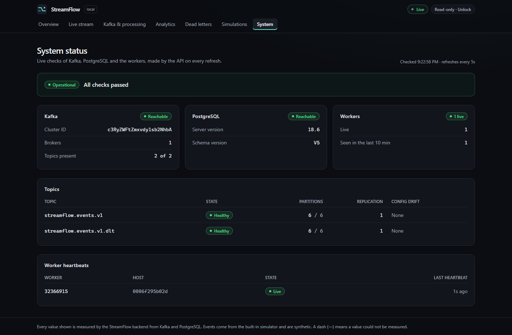

All checks passed:
- Kafka is reachable (one broker, both topics present, 6 partitions each, no configuration drift).
- PostgreSQL 18.6 is reachable, with schema version V5.
- One worker is live, from its heartbeat.

## 3. A bounded synthetic run

From **Simulations**, after unlocking with the operator key, a run of 120,000 events at 1,000 events/s was started
with seed 20261113. While it ran:

| Overview | Live stream | Kafka & processing |
|---|---|---|
| 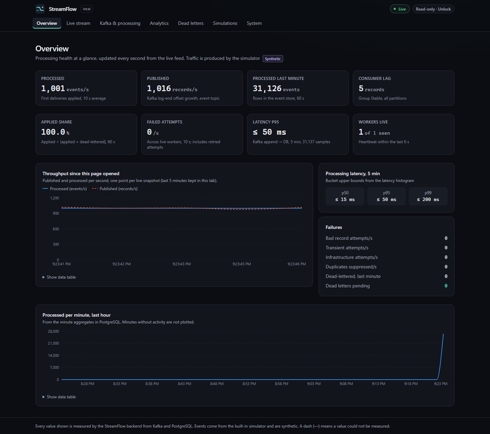 | 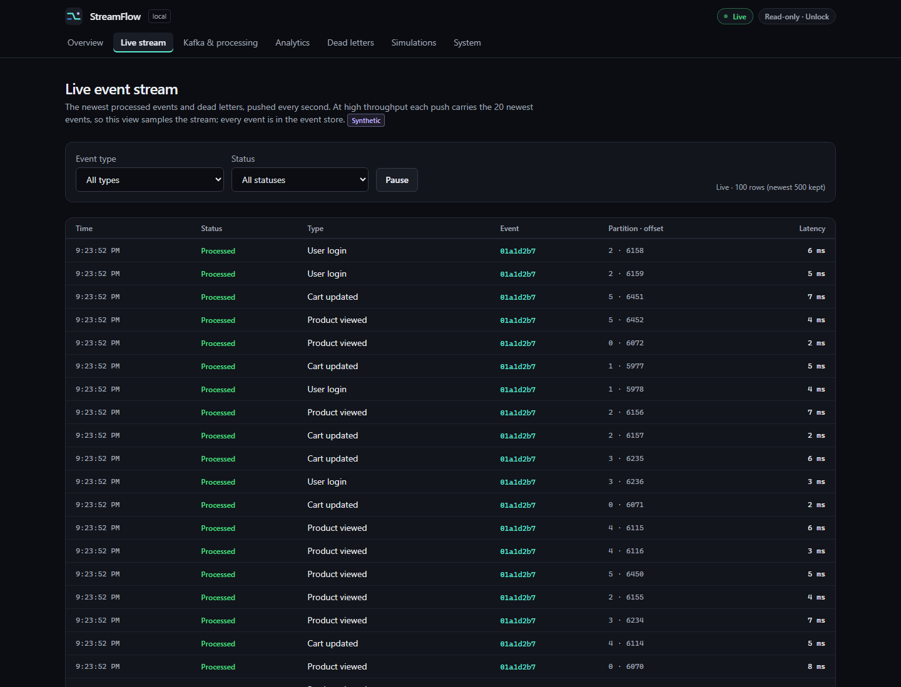 | 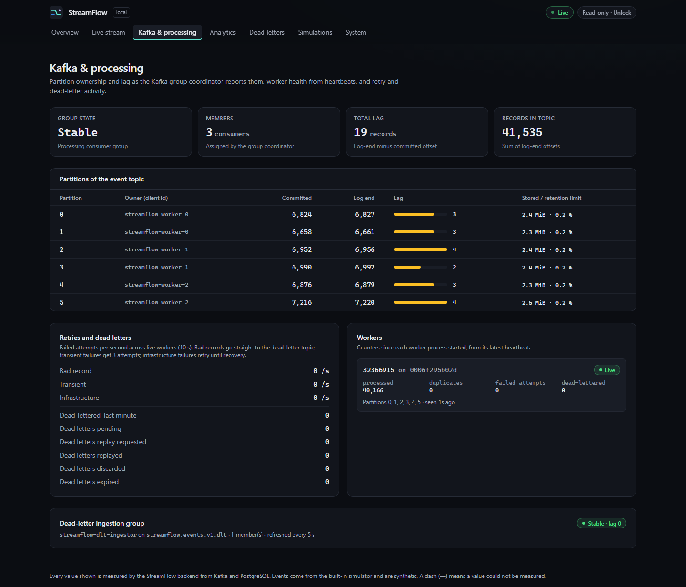 |

- **Overview:** processed 1,001 events/s against 1,016 records/s published; consumer lag 5 records; latency p95
  ≤ 50 ms; one worker live.
- **Kafka & processing:** group Stable with three consumer threads owning two partitions each; total lag 19 records;
  each partition stored about 2.4 MiB, 0.2 % of its retention limit.

## 4. Analytics and run history

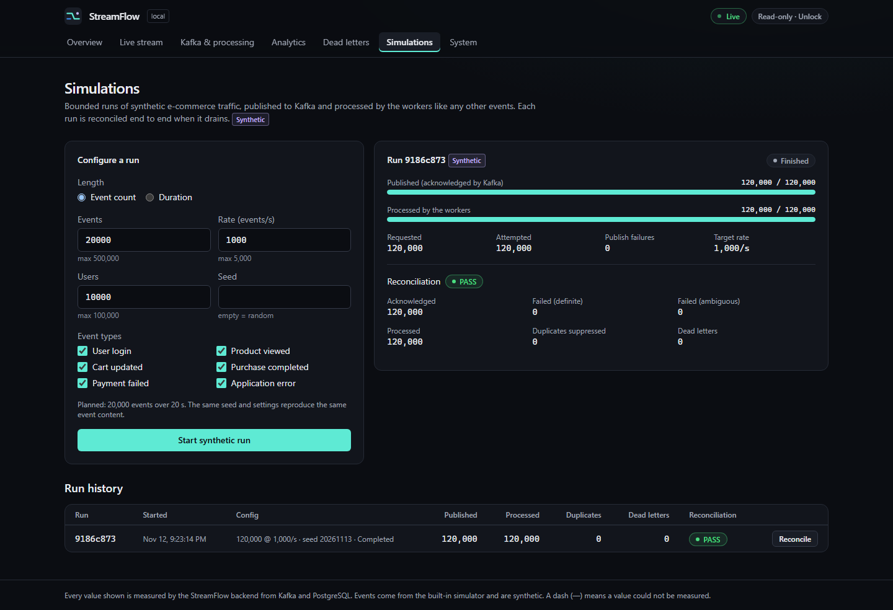

The run finished as follows:
- **Published:** 120,000 of 120,000 acknowledged by Kafka.
- **Processed:** 120,000.
- **Duplicates and dead letters:** 0 of each.
- **Reconciliation:** PASS.

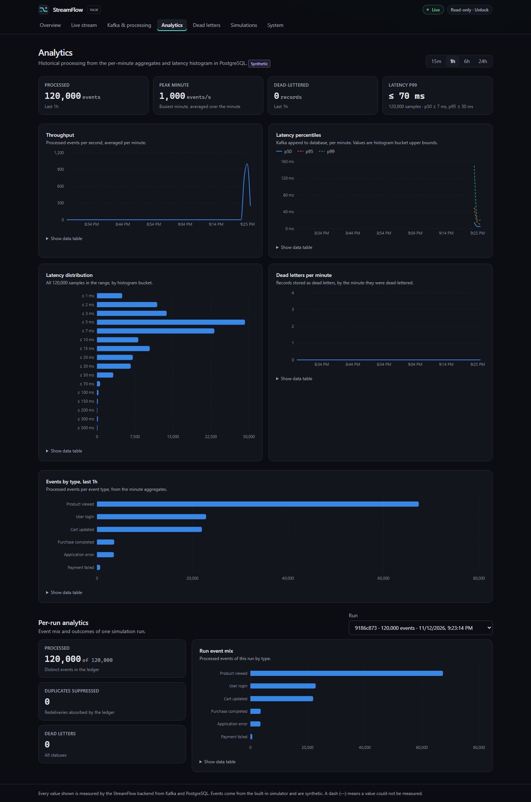

**Analytics** read the per-minute aggregates and the latency histogram: 120,000 events, a peak minute of 1,000/s,
and a p99 of at most 70 ms (histogram bucket upper bound).

## 5. A controlled failure and dead letters

The worker was recreated with the test overlay that allows the predefined fault scenarios (`compose.e2e.yaml`). One
scenario was then activated: reject every `APPLICATION_ERROR` event for 9 minutes, simulating a faulty release. A
second run of 2,000 events at 500/s followed.

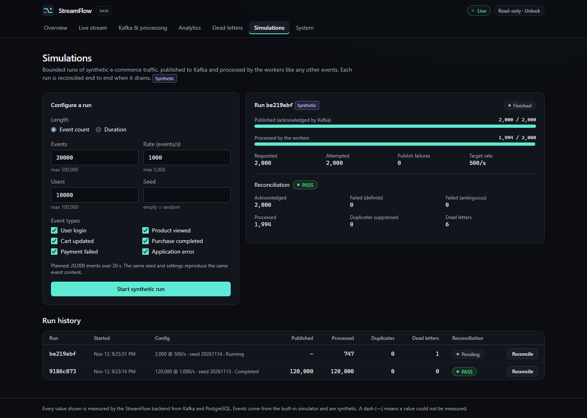
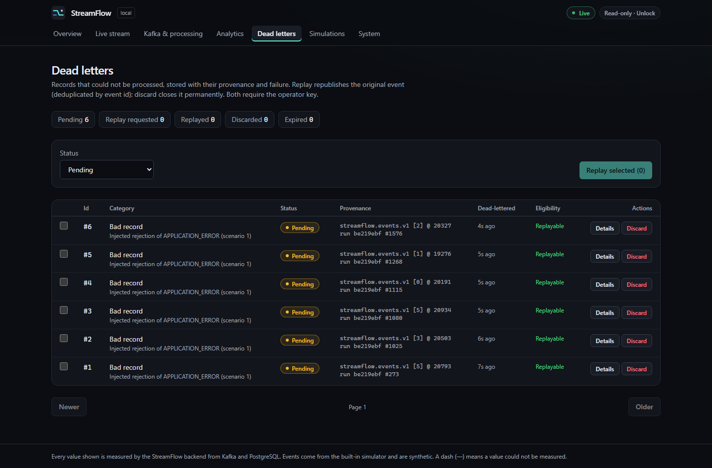

- **Dead letters:** the 6 application-error events in the run were each dead-lettered on their first attempt as
  *Bad record*, with their topic, partition, offset and run sequence.
- **Rest of the run:** the other 1,994 events were processed.
- **Reconciliation:** PASS, with the 6 dead letters counted as unresolved rather than missing.

## 6. Safe replay and reconciliation

The scenario was deleted (the "fix") and the worker recreated without fault injection. The 6 dead letters were
selected, replayed (confirmation dialog), and the run was reconciled again.

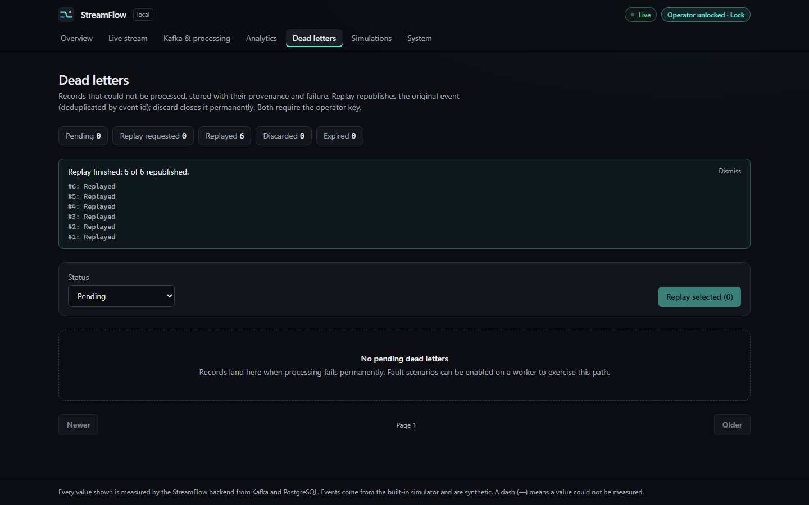
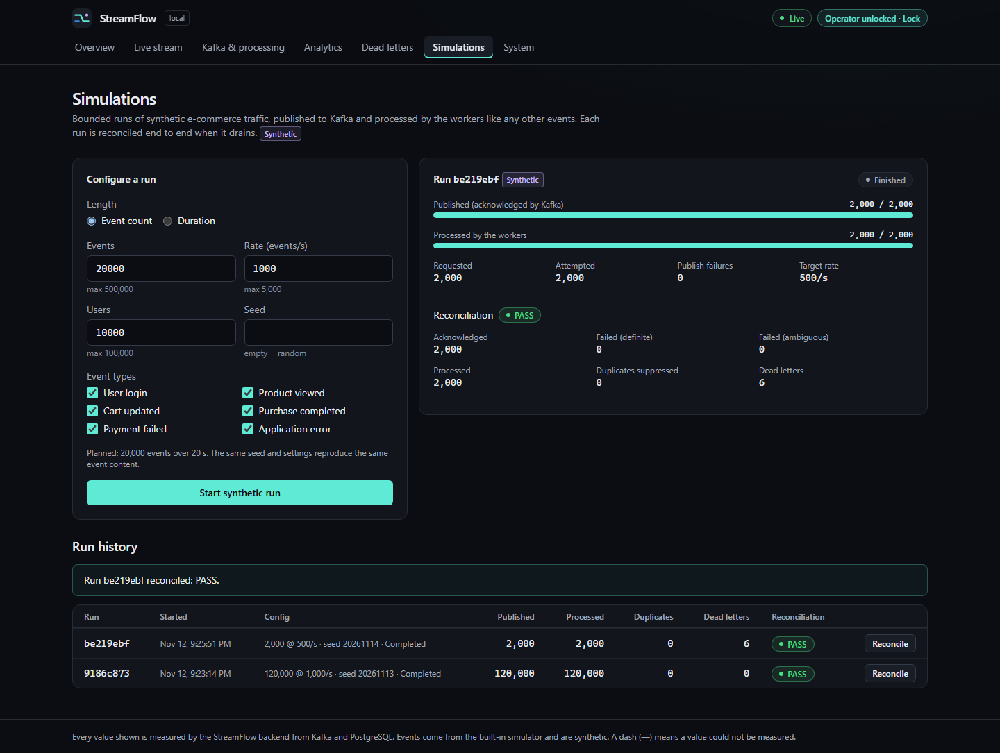

- **Replay:** 6 of 6 republished, and all 6 dead letters became REPLAYED.
- **Reconciliation:** PASS, with 2,000 processed, 6 of them by replay, 0 duplicates, 0 missing and 0 unresolved
  dead letters.
- **Database check:** 2,000 event rows and 2,000 ledger rows for the run.

## 7. Crash recovery

A third run of 40,000 events at 1,000/s was started through the API. 13 s later the worker container was killed
with SIGKILL, and it was restarted 22 s after that.

The run completed and reconciled **PASS**:
- 40,000 of 40,000 processed;
- 0 missing and 0 dead letters;
- 1 redelivered event suppressed by the ledger (its effects had committed before the kill, its offset had not).

## 8. Graceful shutdown and restart

- **Stop:** `docker compose --profile app stop` stopped every service in 3 s. The worker logged
  `Graceful shutdown complete` and removed its heartbeat.
- **Start:** `docker compose --profile app up -d --wait` brought the stack back in 33 s.
- **Counts:** before and after the restart, the ledger held 162,000 events, the event table 162,000 rows, and the
  duplicate-suppression total stayed at 1. A graceful restart caused no redelivery.

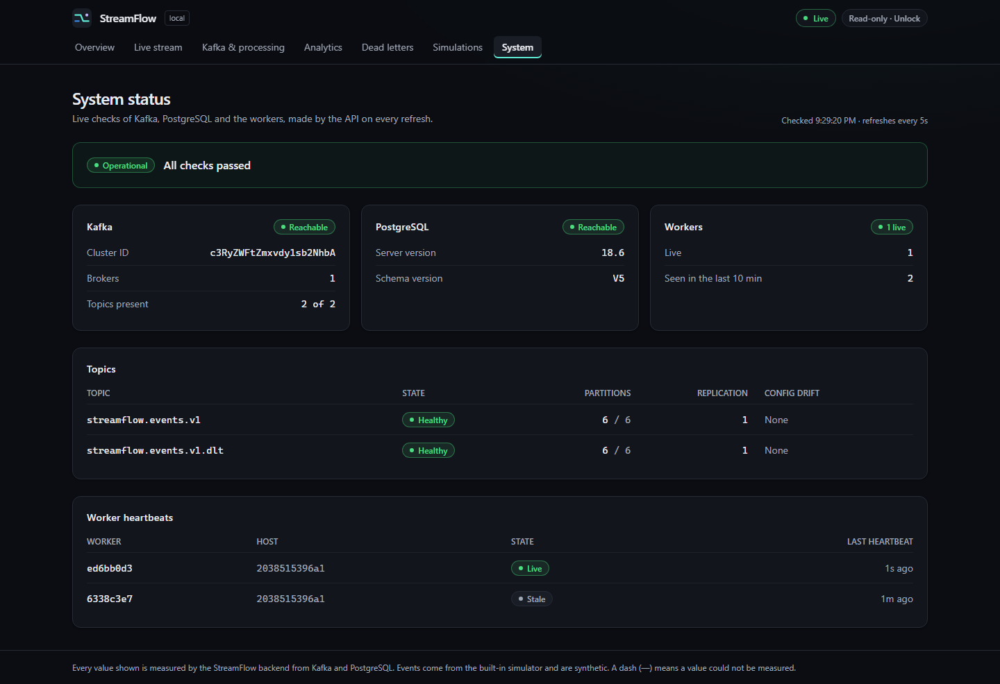

The stack was then stopped. Its volumes were kept.
